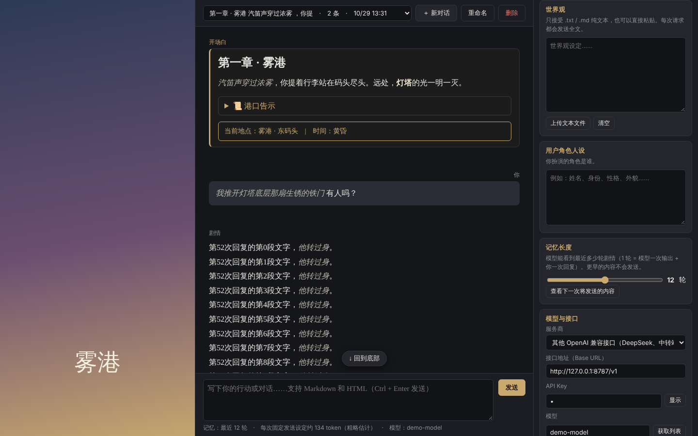

# Proteus

[](https://awesome.re)  

[](https://octocounts.pages.dev/github/IonComan813/ProjectProteus/commit/978d50015a08f43e306a0b796c2cd96f7b7b0e44?analysis=%7B%22ignoredDirs%22%3A%5B%5D%2C%22ignoredLanguages%22%3A%5B%5D%2C%22profile%22%3A%22default%22%2C%22includeDocs%22%3Afalse%2C%22includeTests%22%3Afalse%2C%22includeGenerated%22%3Afalse%7D)

[简体中文](README.zh-CN.md) | English

A roleplay chat app for large language models (LLMs), similar in spirit to SillyTavern; it can also switch to an [assistant mode](#assistant-mode) for ordinary LLM chats. Available as native apps (Windows / macOS / Linux and Android) and as a web version.

The interface is available in Simplified Chinese, Traditional Chinese, English and Japanese. On first launch it follows your system language (English if your system language is none of these four); you can switch at any time at the bottom of the settings panel on the right (on Android, tap ⚙ at the top right and scroll to the bottom). Open source under AGPL v3; you need your own API key.



## Download and install

### Native apps: Windows / macOS / Linux (recommended)

Download the latest version from the [Releases page](https://github.com/IonComan813/ProjectProteus/releases):

| File | Description |
|---|---|
| `Proteus-Setup-<version>-win-x64.exe` | Windows installer; adds shortcuts to the desktop and Start menu |
| `Proteus-<version>-win-x64.zip` | Windows portable version: unzip and double-click `Proteus.exe` |
| `Proteus-<version>-mac-arm64.dmg` | macOS, Apple silicon (M1 and later) |
| `Proteus-<version>-mac-x64.dmg` | macOS, Intel |
| `Proteus-<version>-linux-x86_64.AppImage` | Linux: make it executable and run it |
| `Proteus-<version>-android.apk` | Android (7.0 and later), see below |

The Windows / macOS / Linux apps come with a built-in Chromium engine, so no separate browser is needed. Compared with the web version they also offer:

- **No CORS restrictions**: relay endpoints that don't allow direct browser access work too
- **Data kept separate from your browser**: clearing browser data won't delete it, and other web pages can't read Proteus's data

**Open-source license**: Proteus is released under the AGPL v3. You don't need to accept the license to use the software; modifying or distributing it means you accept the license (section 9 of the AGPL v3). So the license is shown for your information only: the Windows installer shows it on its first page, and you click "Next" to continue (the installer follows the system language: English, Simplified Chinese, Traditional Chinese or Japanese, and English for other languages); the portable, macOS, Linux, Android and web versions show it the first time you open them, and once you click "Acknowledge" it isn't shown again. If there is a new version, the update window appears after that. Later updates don't show the license again.

> The native apps are not code-signed (paid certificates), and the Android app is not installed from an app store, so you may see a warning on first install or launch:
>
> - **Windows** may show "Windows protected your PC" on first run: click "**More info**" → "**Run anyway**"
> - **macOS** may say the developer cannot be verified: go to System Settings → Privacy & Security and click "**Open Anyway**" at the bottom
> - **Android** may block installing apps from unknown sources (the wording varies by phone brand): follow the prompt to allow your browser (or file manager) to "install unknown apps", then go back and tap Install

### Native app: Android

Download `Proteus-<version>-android.apk` on your phone and tap it to install. The first time, Android will ask you to allow your browser (or file manager) to install unknown apps; just follow the prompt.

- The first time you open it, the open-source license is shown; see "Open-source license" above
- The interface uses a mobile layout: the artwork becomes a dimmed background behind the chat; tap ⚙ at the top right to open the settings
- The back button first closes any open menu, window or the settings panel; when there is nothing left to close, "Press back again to exit Proteus" appears in the middle of the screen, and pressing back again within 2 seconds exits
- Exporting a story, world card or backup opens the system share menu, so you can save it to Files, a cloud drive, or send it to someone
- Relay endpoints that block direct browser access (CORS) work too: when a request can't get through, the app resends it through Android's own network connection and remembers that endpoint. For those endpoints the reply appears all at once when it is finished instead of as it is written. The official Claude, OpenAI and Gemini APIs and OpenRouter are not affected and still show replies as they are written
- Only `https://` API addresses work, not plain `http://` (for example a local model server on your network)
- Data on your phone and on your computer are separate; use "Full backup (all conversations)" to move your conversations (app settings and API keys are not in the backup and need filling in again on the other side). The Android app's data is not backed up to your Google account and is not carried over automatically to a new phone; use a full backup to move it

### Web version

Nothing to install:

1. Download the whole folder (**Code → Download ZIP** on the GitHub page, then unzip it)
2. Double-click `index.html` and open it in Chrome or Edge

The notice below the input box says which commit this copy of the web version comes from: if you downloaded it with **Download ZIP** (or "Source code" on the Releases page), it shows the commit and its date, plus the version when that commit is exactly a release, e.g. "(web version v0.4.0, commit abc1234, 2026-11-02)". GitHub writes this into `js/version.js` when it builds the archive; code obtained with `git clone` doesn't have it and just shows "(web version)".

When the window is narrower than 1000 pixels (including on a phone browser), the mobile layout is used automatically.

### Where is my data stored?

All data (settings, conversations, images, API keys) is stored **only on this device**: the native apps keep it in their own data folder, and the web version keeps it in the browser you opened it with. Data is not shared between devices, or between the native apps and the web version; use "Full backup (all conversations)" to move your conversations, and fill in the app settings and API keys again on the other side. You can also back the data up to a private repository on your own GitHub account with "GitHub sync" on the right and download it on other devices (see [GitHub sync](#github-sync)).

Switching computers, reinstalling your system or (for the web version) clearing browser data will make your existing content disappear, so export a "Full backup (all conversations)" regularly from "Export / Backup…" on the right.

### Checking for updates

The native apps (desktop and Android) check the update server for a new version when they start. To keep requests to the server down, they check at most once a day: after a check that finds nothing new, opening the app again on the same day doesn't check, and the first start on the next day does (by date, not 24 hours). A check that can't reach the server doesn't count, so the next start tries again.

- When there is a new version you are told about it: the window shows the current version, the new version and what's new in it. If you skipped versions in between (say, updating from 0.4.6 straight to 0.5.1), it ends with a pointer to the GitHub Releases page for what changed in those
- The buttons are "Download vX" and "Remind me tomorrow". If you don't want to update now:
  - "Remind me tomorrow": nothing is shown when you open the app during the next 24 hours, even if a newer version comes out. The ▾ next to it also has "Remind me in 3 days" (72 hours)
  - "Skip this version" in the ▾ menu: this version is not shown again; you are told when a newer version number comes out. After skipping, the next check is also on the next day
- You have to choose one of the buttons: Esc or clicking outside does not close this window
- The check starts as soon as the app starts, and the window appears as soon as the version information arrives. It opens on top of any other window or dialog, which stay as they were after you choose; it also appears while a reply is being generated, and the reply keeps coming in
- After you choose to download, everything happens by itself: the download runs inside the app (no save dialog) with a progress bar in the middle of the screen (version, percentage, downloaded / total size) and the rest dimmed. While downloading and installing the app is locked: nothing else can be done, the keyboard does nothing, and the progress bar can't be closed with Esc or by clicking outside it; only clicking (or tapping) the × on its right stops the download. When it finishes, the progress bar shows "Download finished, starting the installer…", the conversations are saved and the update is installed without asking again. Unsent text in the input box is put back after the update
- Once the download has finished, the app doesn't check again that day (not even after installing the new version)
- If the installer is blocked and can't run, nothing is shown and the app keeps running
- If the download fails, "Download failed" appears: the download was interrupted or timed out, which may be a network problem or security software blocking it. It counts as timed out after 60 seconds without receiving any data; a download that is just slow but still receiving data doesn't time out. If you pressed ×, "Download stopped" appears instead. Both windows need one of these buttons:
  - "Check for updates again": reads the version information again and shows the update window again
  - "Download it from the GitHub Release page": opens that version's release page in your browser; the app doesn't check again that day
  - "Check again next time the app starts"
- The installer for this device is downloaded (Windows installer / portable, Mac Apple silicon / Intel, Linux or Android); your conversations and settings are kept when you install the new version:
  - **Windows installer version**: the app closes and the installer runs silently into the same folder (with the location and "just me / all users" choice from the first installation), without the license and option pages, then opens the new version. For an "all users" installation Windows still asks once for administrator permission. The installer is kept in the updates folder inside the app data and deleted at the next start. The open-source license was already accepted at the first manual installation
  - **Linux (AppImage)**: the AppImage you are using is replaced by the new version (same path), which is opened before the old one closes
  - **macOS (dmg)**: downloaded to the Downloads folder and opened, then the app closes; drag Proteus into Applications to replace the old version
  - **Windows portable version (zip)**: downloaded to the Downloads folder and its folder opened; after closing the app, unzip it and replace the old folder
  - **Android**: installed directly with the system installer; the app closes while installing, then open it again. The package is deleted as soon as the system has it. The first time you update this way, Android asks you to allow Proteus to install unknown apps and to confirm the installation; on Android 12 and later, later updates need no confirmation
- Only releases are published. Test versions published earlier (with a suffix, such as `0.4.8-beta.1`) are older than the release with the same number, so they are offered the newer release too
- Nothing is shown when the update server can't be reached. The web version does not check for updates

## Interface

| Area | What it does |
|---|---|
| Left | Artwork. Click to upload, then choose portrait or landscape display (see [Landscape display](#landscape-display) below). In portrait the image is shown at the width of the left column without stretching: if it is taller than the column, the top and bottom are cropped; if it is shorter, black bars are added above and below. When the column's width doesn't quite match the image, you're asked whether to adjust it; fairly wide images (wider than 5:4) get a note that they may not look good. Drag the right edge of the column to resize it (up to about 45% of the window, always leaving enough room for the chat); double-click the edge to reset |
| Middle | The story. At the top you can switch, create, rename and delete conversations ("＋ New chat" opens a menu where you choose a "🎭 roleplay", "🤖 assistant" (see [Assistant mode](#assistant-mode)) or "🍺 SillyTavern" chat (see [Loading SillyTavern character cards](#loading-sillytavern-character-cards)); in the list, the emoji before each conversation's name shows its type, followed by its number of rounds and the time of its latest activity — creating it, saving the opening, or sending a request to the model — and the list is sorted by that time; in the open list, left-click switches to a conversation and right-click (long-press on a touch screen) lets you rename or delete it; the list shows the 9 most recently active conversations, and the last item "…" opens the "All conversations" window with the rest. On a computer, clicking a conversation in that window only selects it; click it again or double-click to switch to it (Enter on the keyboard switches directly); on a touch screen a tap switches directly. In that window you can delete several conversations at once: on a computer, Ctrl-click (⌘-click on a Mac) to select or deselect one at a time and Shift-click to select a range, then right-click any selected one; on a touch screen, tick the boxes at the right of each row, then long-press any ticked one. With several selected, the menu only offers Delete; right-clicking (long-pressing) a conversation that isn't selected clears the selection and offers rename and delete for that one); at the bottom is the input box, press **Ctrl + Enter** to send. Drag the edge above the input box to change its height |
| Right | Settings, from top to bottom: System Prompt → World → NPC characters (with the `{{char}}` value) → User's character (with the `{{user}}` value) → Story memo → Key Instructions → Memory length → Model & API → Artwork → Export & backup → App data → Language |

### Landscape display

On a computer (window at least 1000px wide; the phone layout and the Android app don't distinguish, the artwork always fills the background), a landscape image can be shown in landscape: it fills the whole window as the background, with the chat centered and semi-transparent and the image showing on both sides.

- **The settings panel** on the right starts hidden; press **F2** to hide or show it (it floats on the right). The shortcut only works while the app has focus; change it under "Artwork" on the right by clicking "Change" and pressing the new key: F1–F12 (except F5, F11 and F12) or Ctrl / Alt plus a key
- **No stretching**: landscape needs an aspect ratio of at least 3:2. When the window's proportions don't quite match the image, the desktop app asks whether to resize the window (by at most 25% in width or height, and only if it fits on the screen); when they are too far apart to adjust, it says the image isn't supported (the web version can't resize the window and doesn't support differences of more than about 12%). If you resize the window yourself later, the image fills the window with a little cropped when the difference is small, and is shown whole with black bars otherwise
- The display mode belongs to each conversation; change it under "Display" in "Artwork" on the right (the proportions are checked the same way). It is kept in backups, world cards and GitHub sync

Below the System Prompt, world and NPC characters boxes, "Enlarge" opens a large editing window for easier writing; it stays in sync with the box on the right. Click outside it (or press Esc) to close it. On a computer it covers the chat; in the mobile layout (the settings panel opened with ⚙) it covers the settings panel.

"NPC characters" is for the other characters in the world, played by the model; keeping them apart from the world makes both clearer. When a SillyTavern character card is loaded, the character goes here. The one-line box above it is the **`{{char}}` value** (its placeholder reads "{{char}} value") and works like the [`{{user}}` value](#user-value) below: `{{char}}` in the content is shown and sent as this value, and stays as is while it is empty; loading a SillyTavern character card fills in the character's name, which you can change. Like NPC characters, it counts as part of the setting: it is included in world cards and encrypted along with them.

### Each conversation has its own settings

**The System Prompt, world, NPC characters, `{{char}}` value, user's character, `{{user}}` value, key instructions, opening (all versions) and artwork belong to each conversation.** A new chat of the same type copies these from the current conversation (with an empty story); after that the two are independent. Switching back to an older conversation shows that conversation's own settings.

Memory length, Model & API, API keys, interface language and layout are app settings shared by all conversations.

### `{{user}}` value

The one-line box above the user's character (its placeholder reads "{{user}} value"). Wherever `{{user}}` appears in the settings, the opening or the story (in any capitalization; it is common in SillyTavern character cards):

- **Display**: the chat shows it as the value entered here (in the opening, your messages and the model's replies), and so do story exports
- **Sending**: it is replaced with this value in everything sent to the model (System Prompt, world, NPC characters, character, key instructions, opening, story)
- **Storage**: what is saved still says `{{user}}`, so a new value takes effect everywhere at once; the System Prompt, world and other edit boxes also show the original `{{user}}`
- **Left empty**: `{{user}}` is shown and sent as is; models generally understand that it means the user
- If nothing contains `{{user}}`, the value has no effect at all

It belongs to the conversation: a new chat gets a copy, and it is included in full backups, but not in world cards, and it is never encrypted. Assistant mode doesn't use it.

### Story memo

The box below the user's character. In a long story, what is beyond the [memory length](#memory-range) is no longer sent, so the model forgets it. The story memo keeps the key points of the story so far (characters and relationships, places, items, unresolved events, foreshadowing and so on) and is sent with every request to help the model remember.

- **Update memo**: click "Update memo". The request is the same as usual (system settings, the story within the memory length), except that the last message is replaced by an instruction to update the memo, with the current memo attached ("none yet" when there isn't one); the model returns the complete updated memo, which replaces the old one. The story beyond the memory length was already written into the memo back then, so only what happened since needs to be added. While it updates, a green box above the input box says "Updating the story memo…" ("Updating the story memo automatically…" for automatic updates) until the full reply has arrived, and the send button becomes "Stop memo update", which cancels the update and leaves the memo as it was; the memo is also left as it was if the update didn't finish (max output length reached, an error). The previous version isn't kept; fix small mistakes by hand
- **Edit by hand**: you can change it at any time, or click "Enlarge"
- **Update automatically every N rounds**: set per conversation, 0 (off) by default. When on, once N rounds have passed since the last update, the memo updates automatically as soon as that round's reply is finished; you can keep typing in the input box meanwhile
- **Send to the model**: when checked (the default) and not empty, it goes before the message you are sending (after the last reply); see [The story so far](#the-story-so-far) for the format. Unchecked, it is only kept here and not sent; updating still works
- After regenerating a reply or editing or deleting messages, the memo may still contain events that no longer happened; fix them by hand
- Each update is an extra request and uses extra tokens
- The story memo is part of the story: it is included in full backups and GitHub sync but not in world cards, and isn't copied to new conversations (the "Send to the model" and automatic update settings are); in locked conversations it can still be viewed and edited. Assistant mode doesn't use it

### Key Instructions (Post-History Instructions)

The box below the story memo. What you write here is added to **the end of the message you are sending**, so it is the last thing the model reads and the easiest for it to notice: models tend to remember the beginning and the end best and overlook the middle. Use it for reminders about style, length or format, for example "Keep replies under 300 words and write in the third person".

- When it is empty nothing is sent, not even the label
- It is only added to the latest user message (when regenerating, the user message before that reply); it is not saved into the message, and earlier messages don't carry it
- Like the System Prompt, world and NPC characters, it counts as part of the setting: it is included in world cards and full backups and encrypted along with them. Assistant mode doesn't use it

### Opening

When a conversation is completely empty, an "Add opening" button appears below "Send". Click it and the input box switches to editing the opening, with these buttons on the right:

- **Reload**: preview the rendered opening in the chat; the input box keeps its content (Ctrl + Enter does the same). Click again after editing to refresh the preview
- **Confirm**: save the opening and clear the input box; you will then be asked whether to send the opening to the model
- **Cancel**: stop editing the opening

The saved opening is shown at the top of the conversation. Before you send your first message, you can edit or delete it right in the chat; **once the conversation has started, the opening is locked**: it can no longer be edited or deleted, and whether it is sent to the model can no longer be changed (start a new chat for a different opening). Below it is a "Send to the model" checkbox (only the opening has one):

- **Checked**: your first message is merged with the opening and sent to the model as the first message:
  ```
  [Opening]
  …the opening…
  [End of Opening]

  [User]
  …your first message…
  ```
  Once the story has moved on far enough that the first message falls outside the memory length, the opening is no longer sent either.
- **Unchecked**: the opening is only shown in the chat and the model never sees it; your first message is the first message.

**Several openings**: once an opening is saved, the buttons below it include "Add", which lets you write another opening as a new version (edited in the input box in the same way: "Reload" to preview, "Confirm" to save; you are not asked again whether to send it to the model, the existing setting is kept). With several versions, switch between them with `‹ 2/3 ›`; "Edit" and "Delete this version" only affect the version shown, and with a single version left it becomes "Delete opening". **The version shown when you send your first message is the one that is kept**; after that you can no longer switch. When a SillyTavern character card is loaded, its alternate greetings become versions here too.

The opening (all versions) is kept in world cards and full backups; story exports include only the current version.

### Markdown / HTML styling

All messages are rendered as Markdown and HTML, so you can use `<details><summary>` collapsible blocks, custom styles (`<style>`, `style="..."`) and more.

- **The opening** can also use JS (`<script>`)
- **Later messages** (your replies and the model's) have JS disabled and can only use Markdown, HTML and CSS

Each message is shown in its own isolated "sandbox" frame. Its styles and scripts only apply inside that message and don't affect the rest of the interface or other messages. Scripts in the opening cannot read any data from the page (including API keys) and cannot navigate the page away, but they can open new windows (the Windows / macOS / Linux apps open web pages in your system browser).

### Message actions (shown when you hover over a message)

- **No reply at all after sending** (the request failed or was blocked, or you stopped it before any text): the message you just sent goes back into the input box and the conversation ends at the last reply again, so editing it and clicking "Send" retries. The red box above the input says why ("Stopped by you" if you stopped it before any text; stopping after part of the reply shows nothing, since the cut-off ending is visible)
- **No reply at all after editing a user message (or clicking "Get reply")**: the message has several versions, so it stays where it is instead of going back into the input box. The reason stays shown below the message, also after switching to another version and back, as a reminder of what went wrong with that version. Click "Get reply" to retry; the note goes away once there is a reply

- **Regenerate**: only on the last model reply. Old versions are kept and can be browsed with `‹ 2/3 ›`
- **Edit**: only the **most recent** model reply and the **most recent** user message can be edited
  - Editing a model reply changes the current version directly without regenerating, as if you rewrote that part of the story
  - Editing a user message saves it as a **new version** of that message and generates a reply to it; the old version is kept and can be browsed with `‹ 2/3 ›`
  - To change an earlier message, "Roll back to here" first
- **Versions are grouped**: each version of a user message has its own set of model replies. For example, if message A has replies B and C, and you rewrite it as A′ and get replies D and E, then with A selected you can only switch between B and C, and with A′ selected only between D and E
- **Switching and deleting versions** is only available on the last group (the latest user message and the last model reply), so the story stays consistent. Other versions of earlier messages are still saved, and you can switch between them again after rolling back to them
- **Delete this version**: when a model reply has several versions, deletes the one currently shown
- **Roll back to here**: only on model replies. Keeps this reply and deletes every message after it (not available on the last reply). To go back to the opening, just start a new chat
- **Copy**

When you scroll up, "↑ Back to top" appears at the top of the chat; when you scroll down, "↓ Back to bottom" appears at the bottom. Which one appears depends on the direction you scroll, and they are never shown together; neither appears when you are already at the top (or bottom).

While the model is writing you can scroll up and read; the page won't be pulled back to the bottom. To jump to the latest text, scroll down a little and click "↓ Back to bottom".

## Assistant mode

Besides roleplay, Proteus can be used as an ordinary LLM chat tool (a personal assistant), sharing the same API and model settings.

- **Start one**: click "＋ New chat" above the chat and choose "🤖 New assistant chat"
- **Settings**: nothing is carried over from the current conversation — not the opening, System Prompt, world, user's character or artwork. The System Prompt is replaced with a general personal-assistant prompt (one for each interface language; you can edit it). "Reset to default" depends on the conversation's mode: a roleplay chat gets the roleplay default, an assistant chat the assistant default. This mode doesn't use the world, NPC characters, user's character, `{{user}}` value or key instructions, so they are not shown on the right; there is no "Add opening". Artwork can still be uploaded; it is only displayed, never sent to the model (assistant chats can have their own picture too)
- **Sent to the model**: only the System Prompt, the conversation within the memory range and your current message — no world, NPC characters, character, key instructions or opening, and none of their labels (see the next section); `{{user}}` is not replaced. Memory length works as usual
- **New chats**: every type of new chat is chosen in the "＋ New chat" menu. A new chat copies the most recently used conversation of the same type (the current one, if it is of that type): in an assistant chat, "🤖 New assistant chat" keeps the current System Prompt and artwork; "🎭 New roleplay chat" takes the settings, opening and artwork of the roleplay chat you used most recently (or the defaults if there is none). Likewise, a new assistant chat started from a roleplay chat keeps the System Prompt and artwork of the most recent assistant chat, if there is one (a roleplay chat's artwork is not carried over)
- **Export**: only the chat (TXT / Markdown), full backup (all conversations) and log; world cards and single-conversation backups are not offered. "Load world card / backup / SillyTavern card" works as usual: world cards, single-conversation backups and SillyTavern cards are loaded as new conversations, and a full backup's conversations are added to the existing ones, whatever mode the current chat is in
- **Storage**: assistant chats use the same format as roleplay chats with one extra `mode: "assistant"` marker, so they are included in full backups (all conversations) and loaded back as usual. When a full backup is encrypted, assistant chats and their artwork are not encrypted (they have no settings to protect)

> Older versions of Proteus don't know the marker and load assistant chats from a full backup as ordinary roleplay chats (with the assistant System Prompt and an empty world and character); nothing is lost.

## What is sent to the model each time

Each request has two parts: the **system settings** and the **story so far**. This is exactly what goes out. Before sending, you can preview it with "View what the next request will send" below the memory length; afterwards, you can check it with "Export / Backup…" → "Log (last request)".

### System settings

These four parts, in this order, separated by a blank line; empty parts are left out entirely, label included:

| Part | How it is sent |
|---|---|
| System Prompt | As written, with no label |
| World | The label `[World Setting]` on the first line, then the full world setting |
| NPC characters | The label `[NPC Characters]` on the first line, then the full NPC characters text |
| User's character | The label `[User's Character]` on the first line, then the full character description |

In the Anthropic format (official Claude API and Anthropic-compatible relays) this goes in the request's `system` field; in the OpenAI format (official OpenAI, Gemini, OpenRouter and other relays) it is the first `system` message.

### The story so far

User messages and model replies, alternating:

- **Range**: the last one is your current message (when regenerating, the user message before that reply), preceded by the most recent N rounds. N is the memory length, 1–40 rounds; **1 round = one message from you + the model's reply to it**. Older messages are not sent
- **Versions**: only the version currently shown of each message is sent
- **Opening**: it does not count as a round of its own. If it is set to be sent and the conversation's first message is still within range, it is merged with the first message into one user message:
  ```
  [Opening]
  …the opening…
  [End of Opening]

  [User]
  …your first message…
  ```
  When the opening is not sent, the first message is sent as is, without labels
- **Story memo**: when it is set to be sent and isn't empty, it goes before the last user message (your current message): the label `[Story Memo]` on its own line, then a fixed sentence telling the model that this is a summary of the story so far rather than your message, and that it may contain entries beyond the context window that it can't find in the story, then the full memo, then `[End of Story Memo]`; after a blank line come the label `[User]` and your message (the first message, combined with the opening, already has that label)
- **Key instructions**: if there are any, they are added to the end of the last user message (your current message): a blank line, then the label `[Key Instructions]` on its own line, then a fixed sentence telling the model that these are instructions sent to it directly, outside the story, rather than your actions in the story (not shown anywhere in the interface except the request preview), then the full key instructions. If the box is empty nothing is added
- **Earlier story omitted**: the Anthropic format requires the first message to be from the user. If the range happens to start with a model reply, a user message reading `(Earlier story omitted)` is added in front. This doesn't happen in a normally alternating story
- If two messages in a row ever come from the same side, they are merged into one (separated by a blank line) so the API doesn't reject the request

In everything above, the system settings included, `{{user}}` is replaced with the [`{{user}}` value](#user-value) and `{{char}}` with the `{{char}}` value (above "NPC characters"); each stays as is while its value is empty.

### Example

Memory length 1 round, the opening set to be sent, and you are sending your 3rd message: only round 2 is included; round 1 is out of range, and the opening goes with it.

```
[system]     System Prompt
             (blank line)
             [World Setting]
             …world setting…
             (blank line)
             [NPC Characters]
             …NPC characters…
             (blank line)
             [User's Character]
             …character…
[user]       2nd message
[assistant]  2nd reply
[user]       3rd message (this one)
             (blank line)
             [Key Instructions]
             Below are instructions the user especially wants you to note and follow. …(fixed sentence)
             …key instructions…
```

Without key instructions the last four lines are left out. With a memory length of 2 rounds, round 1 is in range too, and the first user message takes the `[Opening] … [User]` form shown above.

### Label language

Labels follow the interface language **at the time the request is sent**:

| | 简体中文 | 繁體中文 | English | 日本語 |
|---|---|---|---|---|
| World | `【世界观设定】` | `【世界觀設定】` | `[World Setting]` | `【世界観設定】` |
| NPC characters | `【NPC角色】` | `【NPC角色】` | `[NPC Characters]` | `【NPCキャラクター】` |
| User's character | `【用户角色人设】` | `【使用者角色設定】` | `[User's Character]` | `【ユーザーキャラクター設定】` |
| Start of opening | `【开场白】` | `【開場白】` | `[Opening]` | `【オープニング】` |
| End of opening | `【开场白结束】` | `【開場白結束】` | `[End of Opening]` | `【オープニングここまで】` |
| First message, message after the story memo | `【用户】` | `【使用者】` | `[User]` | `【ユーザー】` |
| Start of story memo | `【剧情备忘】` | `【劇情備忘】` | `[Story Memo]` | `【ストーリーメモ】` |
| End of story memo | `【剧情备忘结束】` | `【劇情備忘結束】` | `[End of Story Memo]` | `【ストーリーメモここまで】` |
| Key instructions | `【重点指令】` | `【重點指令】` | `[Key Instructions]` | `【重点指令】` |
| Earlier story omitted | `（前情省略）` | `（前情省略）` | `(Earlier story omitted)` | `（前略）` |

The model name, maximum output length, effort or temperature and other parameters come from "Model & API".

### Assistant mode

Only two parts are sent, with no labels at all:

```
[system]     System Prompt (as written)
[user]       …
[assistant]  …
[user]       your current message
```

Range, versions and merging of same-side messages work as above; there is no opening, the world, NPC characters, character and key instructions are not sent, and `{{user}}` is not replaced.

### Memory range

Older messages are not sent, so the model can't "see" them. A dashed line in the story marks the edge of the memory range; messages above it are still shown, the model just can't see them.
You can edit the number in the memory length box directly or adjust it with − / ＋. Below it is an estimate of how many tokens the next request will use. It is worked out from exactly the same content as the window below and matches the total at its top, including the text currently in the input box (as your next message).

**The token estimate calibrates itself from actual usage**: at first it is a rough estimate (about 1 token per Chinese, Japanese or Korean character, and 1 token per 4 other characters). After each request, Proteus reads the input usage reported by the API and corrects later estimates automatically; there is nothing to set up:

- It keeps separate records per relay (API address) and per model on that relay. The same model name on different relays, or on a relay and the official API, is counted separately; a relay whose addresses in the two compatible modes differ only by a trailing `/v1` counts as one relay. A model used for the first time on a relay starts from what the relay's other models have shown, but only as a starting point: once it has its own data each model is calibrated on its own, so switching back and forth between models on the same relay doesn't pull them around
- Once stable, it corrects more slowly: when the smoothed error of the recent estimates is within 5% and there are at least 5 requests, each new request's influence drops from about 1/10 to about 1/30, so a single request can't widen the deviation again; if the smoothed error goes above 10%, or two requests in a row are far off in the same direction (something really changed, e.g. the relay switched upstream), it goes back to the normal speed and catches up quickly
- Chinese/Japanese/Korean text and other text are calibrated separately (languages convert to tokens at different rates), and a fixed overhead added by a relay is learned too
- Estimate = sum of the parts + added amount: each part (each piece of the system part and each message) is a × Chinese/Japanese/Korean characters + b × rough estimate of the other text (an empty part is 0), and the added amount is the learned fixed overhead c (content a relay adds itself, plus each message's formatting). A model used for the first time on a relay starts with that relay's a, b and c, so there can be an added amount before its first request. Below the estimate you also see the estimated input tokens of the conversation's last request (as estimated when it was sent), and the actual input and output tokens the API reported, with the deviation ((estimate − actual) ÷ actual; negative means the estimate was too low). When a reply is cut off or stopped, the API may not report the output usage (shown as "output tokens not reported"), and in the OpenAI format there may be no usage at all ("no usage reported by the API"). When a request fails without any reply, the message you sent goes back into the input box and the request doesn't appear, so "last request" still shows the one before
- Calibration starts gradually from the first request (with no data the estimate is the rough one), so the hint always says "calibrated step by step from the usage the API reports". In "View what the next request will send" each part is multiplied by the calibrated coefficients, and the total at the top reads "sum of the parts + added amount = total"; the added amount is the fixed overhead c (for example content a relay adds itself) and can be negative. Only numbers are recorded, never conversation content; "Clear app data" deletes them, and "Full backup (all conversations)" includes them so you can carry on on another device
- Reading usage: in the Anthropic format (official and compatible relays) the input is `input_tokens` plus the tokens written to and read from the cache; in the OpenAI format (OpenAI official, Gemini and compatible relays) it is `prompt_tokens`. Streaming replies in the OpenAI format only report usage when the request includes `stream_options` (Gemini's OpenAI-compatible API supports it too). A few APIs reject that parameter; Proteus then resends once without it and remembers the address so it isn't added again. If such an API doesn't report usage either, the estimate stays rough

**When the actual usage is wildly different from the estimate**: when the actual figure is under 1/5 of the rough estimate or over 50 times it, it is shown but not used for calibration. For a model that is already calibrated (at least 3 requests) the rule is stricter: a figure more than 3 times off the calibrated estimate is ignored the first time, and only counted once the next request is far off in the same direction too (then something really changed). Such figures are usually not a tokenizer difference (models and languages differ by tens of percent at most) but a problem with how the API reports usage:

- **Only the uncached part is reported**: the most common case. Once the cache is hit, some relays converting the Anthropic format to the OpenAI format fill in only the uncached `input_tokens` (or drop the cache fields), so a request of tens of thousands of tokens looks like a few dozen
- **Fake numbers**: always 0 or 1, or a fixed value unrelated to the request; some account pools and reverse-engineered channels don't count at all
- **Billing quota instead of tokens**: figures converted with a price multiplier, which can be dozens of times the real tokens
- **The API changed the content**: the relay truncated or compressed the context (for example OpenRouter's middle-out), so far less was processed than sent

Two other cases also differ a lot, but the figures are real and are used for calibration as usual:

- **The relay adds a long hidden system prompt** (for example channels resold from Claude Code or Cursor accounts, often with prompts of ten thousand tokens or more): short conversations come out ten or twenty times the estimate; the fixed overhead c learns this, and it matters less as the conversation grows
- **The relay counts with a different tokenizer** (for example counting Claude with OpenAI's tiktoken): off by 10–40%, which is why each relay is calibrated separately

### Sharing token calibration data (currently off)

Calibration happens only on this device; nothing is uploaded or downloaded. A feature for sharing calibration coefficients anonymously between users was built (server in `worker/calibration`, client in `js/tokens.js`); the code is kept but currently turned off, and how to turn it on is described at the top of `js/tokens.js`.

## Export and backup

"Export / Backup…" under "Export & backup" on the right offers:

| Option | Includes | Does not include |
|---|---|---|
| Story (TXT / Markdown) | The current conversation's opening and all messages | System Prompt, world, character, artwork |
| Chat (TXT / Markdown) (assistant mode) | All messages in the current conversation | System Prompt |
| World card (JSON, can be encrypted) | The current conversation's System Prompt, world, NPC characters, key instructions, opening (all versions, and whether it is sent to the model), artwork | User's character, `{{user}}` value, story |
| Full backup (this conversation) (JSON, can be encrypted) | Everything in the current conversation: System Prompt, world, NPC characters, user's character, `{{user}}` value, key instructions, opening (all versions, and whether it is sent to the model), story (including every version of every reply), artwork | App settings |
| Full backup (all conversations) (JSON, can be encrypted) | Every conversation (with all its content, as in "Full backup (this conversation)") and the token calibration data (merged with this device's on loading) | App settings (memory length, Model & API, API keys, interface language, layout, etc.) |
| Log (last request) (TXT) | The request actually sent to the model the last time (API address, headers, JSON body) and the raw response received, for troubleshooting. Only the last request since the app was opened; not saved | API keys; locked settings from encrypted world cards (shown as "(protected content)") |

In an assistant chat only the chat, full backup (all conversations) and log are offered, see [Assistant mode](#assistant-mode).

"Load world card / backup / SillyTavern card" accepts world cards, both kinds of full backup, and SillyTavern character cards and lorebooks (see [Loading SillyTavern character cards](#loading-sillytavern-character-cards)). It also works from an assistant chat:

- **Loading a world card** creates a new conversation with the card's System Prompt, world, NPC characters, key instructions, opening and artwork, and an empty user's character and `{{user}}` value; existing conversations are not affected
- **Loading a full backup (this conversation)** creates a new conversation exactly as it was backed up; existing conversations are not affected (loading the same backup twice gives two conversations)
- **Loading a full backup (all conversations)** adds the backup's conversations to your existing ones, which stay as they are. Conversations that are the same as an existing one are added too (loading the same backup twice gives two copies); delete the ones you don't need. App settings are not in the backup and are left alone when loading (settings in backups made by earlier versions are ignored too), and you stay in the conversation you were in. Use it to move your conversations to another device, then adjust the settings there

Images are stored in the JSON as text (base64), so world cards and backups with images are about a third larger than the images themselves. The artwork can also be downloaded on its own under "Artwork" on the right.

### Encrypted world cards (protecting a creator's settings)

When exporting a world card or full backup you can choose to **encrypt** it with a 4–16 character password (in an encrypted full backup, the story and user's character stay in plain text; only the items below are encrypted):

- Opening the file directly shows only gibberish
- After loading it in Proteus, the System Prompt, world, NPC characters, key instructions, opening and artwork are **locked**: they can be used normally but not viewed, edited, copied or downloaded; the opening is displayed as usual, but versions cannot be edited, added or deleted, and whether it is sent to the model cannot be changed (with several versions you can still switch between them before the conversation starts). The user's character, `{{user}}` value and story are not affected
- Entering the password unlocks it, turning it back into a normal conversation
- A new conversation created from a locked one, and world cards or full backups exported from it, stay encrypted with the original password. You are reminded before exporting that the original password is still needed to unlock it (you are not asked whether to encrypt in this case; normal conversations in a "Full backup (all conversations)" can still be encrypted)
- **SillyTavern conversations cannot be encrypted**: exporting their world card or full backup does not ask whether to encrypt and exports plain text; in an encrypted "Full backup (all conversations)" they stay in plain text, like assistant-mode conversations. A SillyTavern card is its author's work, published without a lock, so whoever loads it should not be able to lock it. Use a roleplay conversation for settings you wrote yourself

> **Limits of encryption**: for the model to use these settings, Proteus has to decrypt them on your device and send them to the model API in plain text, and this project is open source. So encryption only prevents viewing the file directly and copying inside the app; **it cannot stop a technically capable person who is determined to get the content** (for example by inspecting the requests sent to the model, or asking the model to repeat the settings).

## GitHub sync

"GitHub sync" on the right backs up your conversations, provider settings (including API keys) and token calibration data to **a private repository under your own GitHub account**, and downloads them on other devices. The data only travels between your devices and your repository, never through the developer's servers.

- **Sign in**: click "Sign in to GitHub" and a code appears. Click "Copy code and open page", enter the code on GitHub's page and approve. This needs the `repo` scope (the only scope that allows creating and writing private repositories; it covers all your repositories), but Proteus only reads and writes the one sync repository, and the code is open source for you to check. The sign-in credential is stored only on this device, encrypted (with the system keychain in the desktop app, and with a non-exportable key generated by the browser in the Android app and the web version), and never goes into any export or backup. Signing out only deletes the local credential; to revoke access completely, go to GitHub Settings → Applications → Authorized OAuth Apps.
- **Repository**: after signing in, Proteus looks for `proteus_sync` under your account and uses it if it exists (if it is public it isn't used; make it private on GitHub first); otherwise you can pick one from the list of private repositories on your own account (most recently updated first; type to filter; public and archived repositories, and repositories you're a collaborator on or that belong to organizations, aren't listed) or create a new private one (named `proteus_sync` by default; you can change it). To avoid changing your other repositories, Proteus only uses empty ones (or ones with only a README, LICENSE or .gitignore) and ones it has synced to before. After creating one you can upload everything on this device right away; when you choose an existing one its conversations are listed (with title, rounds and time when there are 5 or fewer) and you choose one of the four operations below.
- **Operations**:
  - This conversation: "Back up this conversation to the repository (overwrite)", "Download this conversation (overwrite)"
  - All conversations: "Upload to repository (overwrite)" makes the repository exactly like this device (conversations that aren't on this device are deleted from it, and the LLM settings and calibration data are overwritten); "Upload to repository (incremental)" uploads only conversations the repository doesn't have (per conversation; ones it already has are skipped even if changed) and adds providers it doesn't have; "Download (overwrite)" makes this device exactly like the repository (after a confirmation saying how many conversations will be deleted), including the LLM settings; "Download (incremental)" only downloads conversations and providers this device doesn't have
  - Each of the six buttons first opens a window saying what will happen (how many conversations, whether anything is deleted) and only runs after you confirm
  - Each operation makes one commit in the repository whose message gives the time and what was done (e.g. "Proteus · 2026-11-07 20:38 (UTC+8) · Upload (overwrite): uploaded 3 conversations, deleted 0"), so anything overwritten or deleted can still be found in its history
- **Encryption**: on the first upload to a repository you're asked whether to "Encrypt settings" and "Encrypt API keys", and whether to upload artwork. Encryption works as for local exports: roleplay settings and artwork are encrypted with the app's built-in key and a password you set unlocks them for viewing; the story isn't encrypted, and neither are assistant and SillyTavern chats; API keys use the same password. Later uploads don't ask for the password again. When a download contains encrypted content you're asked for the password once: enter it to unlock right away, or cancel to keep the conversations locked (unlock them one by one later on the right) and skip the API keys. The encryption settings can be changed later under "GitHub sync" and apply from the next upload. Access to a private repository is itself the gate: only you and people you invite can see it
- **Artwork**: each conversation decides whether its artwork is synced ("Sync this conversation's artwork to the GitHub repository" under the artwork on the right); "Sync artwork" under "GitHub sync" is the global setting and changing it applies to all conversations. For conversations that don't sync artwork, uploads leave it out and downloads leave the artwork on this device alone
- **Files in the repository**: `conversations/<conversation id>.json` has the same format as a local "Full backup (this conversation)", `settings.json` holds the LLM settings and `calibration.json` the token calibration data; you can download any of them and read it with "Load world card / backup / SillyTavern card" (reading `settings.json` overwrites the LLM settings on this device and asks for the password if the keys are encrypted). `proteus-sync.json` is the sync marker with the encryption settings, and `index.json` is the conversation list
- **Signing in from the web version**: GitHub's sign-in endpoints can't be called from a web page (cross-origin), so before signing in from the web version, run `node scripts/github-login-proxy.js` on this computer (Node.js 18 or later; a web page can't start programs on your computer). It only forwards the two sign-in addresses on `127.0.0.1:8787`, only answers the web version's own origins (the page opened as a local file, or served from `localhost` / `127.0.0.1`) so other websites can't use it, and closes by itself once you're signed in. When you click "Sign in to GitHub" in the web version it first checks whether the proxy is running; if not, it shows the command to run (with a copy button), and you click "It's running, continue" once it's up. The desktop and Android apps don't need it

## Loading SillyTavern character cards

Proteus can load SillyTavern character cards and lorebooks. What you load becomes a **SillyTavern chat** (🍺 before its name in the list). Loading only: Proteus does not export to SillyTavern formats.

There are two ways to load them:

- "Load world card / backup / SillyTavern card" on the right
- "🍺 New SillyTavern chat" in the "＋ New chat" menu: in a SillyTavern chat it creates a new SillyTavern chat with a copy of all the current settings (not the story); in any other chat it asks you to load a SillyTavern file first and then lets you choose a character card or lorebook (only SillyTavern files are accepted there)

Supported files:

- **PNG character cards** (V1 / V2 / V3); the image itself becomes the artwork
- **JSON character cards**
- **Standalone lorebooks** (JSON, as exported by SillyTavern or Chub)
- The V3 CHARX (zip) format is not supported

### At most one lorebook and one character per conversation

A character card may or may not include a lorebook; a standalone lorebook never contains a character. So a SillyTavern chat can be made of "lorebook + character card", loaded in either order. Where a file goes follows these rules:

| Current conversation | Loading a lorebook | Loading a character card |
|---|---|---|
| Not a SillyTavern chat, already started (a message has been sent; a saved opening alone does not count), or locked | New conversation | New conversation |
| Lorebook only | New conversation (two worlds cannot share one conversation) | **Added to this conversation** |
| Character card only (without a lorebook) | **Added to this conversation** | No group chats: you are asked whether to create a new conversation (load a lorebook into it afterwards if you need one) |
| Lorebook + character card (including a card's own lorebook) | New conversation | Same as above |

A character card with its own lorebook cannot be added to a conversation that already has a lorebook; it gets a new conversation. A new conversation starts with an empty user's character and `{{user}}` value; existing conversations are not affected.

A lorebook goes into "World" and a character into "NPC characters". When added to a conversation, it **replaces** that box; if the box already has content (your own text), you are asked first. Once a conversation has started, a new setting could contradict the story so far, so a new conversation is always created.

### Where a character card's content goes

| SillyTavern field | Proteus |
|---|---|
| Name (`name`) | The title of a new conversation; it fills in the `{{char}}` value (you can change it), and every `{{char}}` in the conversation is shown and sent as that value |
| Image | Artwork (when added to a conversation, only if that conversation has no artwork yet) |
| System Prompt (`system_prompt`) | System Prompt. Where the card says `{{original}}`, the existing System Prompt is put in its place (the author adds to it). In a new conversation, the default is used if the card has none. When added to a conversation, the card's prompt is used directly if the current one is still the default; if you have changed it, you are asked first, and the dialog shows what it would become |
| Embedded lorebook (`character_book`) | "World" (full text) |
| Description, personality, scenario, example dialogue | "NPC characters": headed "Character: name", each with its own subheading |
| First message (`first_mes`) and alternate greetings (`alternate_greetings`) | Versions of the opening, with "Send to the model" checked. When added to a conversation, they go after the existing versions |
| `post_history_instructions` | Key instructions (with any `{{original}}` removed). When added to a conversation, they are used directly if the current key instructions are empty; otherwise you are asked first |
| Creator's notes (`creator_notes`) | Not sent to the model; shown once after loading |
| Tags, creator, version, extensions (regex scripts etc.) | Ignored |

A standalone lorebook goes into "World" in full.

**Lorebooks**: SillyTavern triggers lorebook entries by keyword and only sends the entries that match; **Proteus does not trigger them by keyword: it puts the full text into the world and sends it with every request**. When loading, you are told how many entries there are and roughly how many tokens they take. Disabled entries are skipped; constant entries come first and the rest follow in insertion order; entries with a name (or comment) get it as a heading.

### Macros

- `{{char}}`: kept in the content, and shown and sent as the `{{char}}` value above "NPC characters"; loading a character card fills in the character's name, and it stays as is while the value is empty. So when you load a lorebook first and add a character card later, `{{char}}` in the lorebook works too
- `{{user}}`: kept, and shown and sent as the [`{{user}}` value](#user-value)
- `{{// …}}` (author's comments): removed when loading
- In older cards, `<USER>` is treated as `{{user}}`, and `<BOT>` and `<CHAR>` as `{{char}}`
- Other macros (such as `{{random:…}}`) and `<START>` in example dialogue are left as is

World cards and full backups exported from a SillyTavern chat keep this mark (with the character and lorebook names), so they load back as SillyTavern chats.

Cards that rely on SillyTavern-only features (regex scripts, STscript, front-end extensions, etc.) lose those effects; HTML status bars written directly by the model are displayed as usual.

## Shared devices

- "Remember API keys on this device (global setting)" under "Model & API" (the add-provider window has the same checkbox): when unchecked, the API keys of all providers only last until you close the page and are never written to this device. Note that the Vertex service account file is one you downloaded yourself and Proteus only reads its content; it stays on this device unless you delete it
- "Clear app data" under "App data" on the right: deletes every conversation, setting, artwork and API key saved by this app. The web version keeps its data in the browser you open it with, separate from the native apps; clearing one does not affect the other (the confirmation marks whichever one you are using with "(this app)")

## API key security

Proteus runs on your own device. API keys are stored only in the app's data on this device (for the web version, the browser's storage) and never pass through any third-party server, and exported world cards and backups never include them. Please note:

- (Web version) In Chrome, all local web pages opened by double-clicking share the same storage, so in theory a malicious local HTML file could read the data Proteus has saved. Don't open HTML files of unknown origin in the same browser, or use a native app instead; the native apps keep their data completely separate from your browser
- In world cards shared by others, the opening may contain JS. It runs in an isolated sandbox and cannot read your API keys or data, but it can load external resources such as images (and so can tell that someone opened the card)
- The web version has only been tested in Chrome / Edge; Firefox and Safari have unreliable storage support for local web pages

## Supported providers

| Option | Notes |
|---|---|
| Claude (official) | Calls Claude directly (Anthropic's API) |
| ChatGPT (official) | OpenAI's API (the API key comes from the OpenAI developer platform, separate from a ChatGPT subscription) |
| Google AI Studio | Uses Gemini's OpenAI-compatible API; get an API key from [Google AI Studio](https://aistudio.google.com/). On the free tier, larger models are often busy (HTTP 503) or slow to respond, so a small model such as `gemini-3.5-flash-lite` is a good start; if you get a 503, wait a moment and click "Get reply" or "Regenerate" |
| Google Vertex AI (now Gemini Platform) | No API key: click "Import service account JSON…" and choose a JSON key created in the Google Cloud console under "IAM & Admin → Service accounts → Keys" (the service account only needs the "Vertex AI User" role). The file holds the service account's private key; Proteus signs with it to get a one-hour access token from Google and renews it before it expires. Gemini models use Vertex's OpenAI-compatible API (`google/` is added to model names without a prefix); model names containing `claude` switch to Claude's API automatically (`…/publishers/anthropic/models/<model>:streamRawPredict`, Anthropic format with `anthropic_version` in the body and no `model`). The location is fixed to `global`. The private key is stored on this device like an API key and follows "Remember API keys on this device" |
| OpenRouter | All models (including Claude and Gemini) use the same OpenAI-compatible API, `https://openrouter.ai/api/v1`; model names carry the vendor prefix, e.g. `anthropic/claude-sonnet-5-5`. Extra settings: "Thinking depth" works for every vendor's models (OpenRouter's unified `reasoning.effort`, converted per vendor); "OpenRouter upstream choice" puts the lowest price, fastest output or lowest latency first (`provider.sort`); "Don't use upstreams that store request data" (`provider.data_collection: deny`). Requests carry Proteus's project URL and name (`HTTP-Referer`, `X-OpenRouter-Title`) for OpenRouter's app attribution. If you had added OpenRouter by its address and the built-in one has no key yet, it moves into the built-in OpenRouter after the update |
| OpenCode | OpenCode Console (Zen)'s OpenAI-compatible API, `https://opencode.ai/inference/openai/v1`; all paid models (including Claude) work. Free models only work in OpenCode's own client |
| Command Code | Command Code's Provider API. Model names containing `claude` switch to the Anthropic format (`https://api.commandcode.ai/provider/v1/messages`) automatically; other models use the OpenAI format (`https://api.commandcode.ai/provider/v1/chat/completions`). The Go plan has no API access |
| ＋ Add a provider… | DeepSeek, various relays, etc.; add as many as you like. In the window that opens, enter a name (anything you like), choose the compatibility mode (OpenAI-compatible: most relays; Anthropic-compatible: the few relays that offer Claude's native format), the API address (OpenAI-compatible ones usually end with `/v1`) and API key, and click "Get model list" to test it and pick a model. You can save whether or not that works, as long as the name, compatibility mode and API address are filled in. Esc or clicking outside doesn't close this window (so you don't lose what you typed); use "Cancel" or "Save". Once saved it appears in the provider list; changes to its name, compatibility mode, address, key or model under "Model & API" are saved automatically, and you can delete it there |

The API addresses of the seven built-in providers above are fixed: they are shown but can't be edited; only providers you add yourself take an address. Settings you had under "Other OpenAI-compatible" or "Other Anthropic-compatible" in earlier versions, and addresses you had changed on the three official providers, each become an added provider after the update, named after the API address's domain.

Click "Fetch list" to get the available model names from the API; then click ▾ at the right of the model box to choose from the list (you can also type a name; the list filters as you type). Only chat models are listed: image, video, speech, music and 3D generation models, and embedding, moderation, reranking and realtime voice models are left out (Proteus only sends and reads text chat; you can still type such a model name if needed). The fetched list is remembered and sorted by name: numbers compare by value (`8b` < `70b`), and within a series older, smaller and weaker models come first (for example `gpt-4o-mini` < `gpt-4o` < `gpt-4.1`, `gemini-2.0-flash-lite` < `gemini-2.0-flash` < `gemini-2.5-pro`, `claude-3-haiku` < `claude-3-sonnet` < `claude-3-opus`). If the standard location (`<address>/models` for the OpenAI format, `<address>/v1/models` for Anthropic) has no list, a few common locations are tried too (for example dropping the path segment before `/v1`, or `/v1/models` on the domain); if none works, you can type the model name.

### About the official Claude API

- The latest API version is used. It does not accept the `temperature` parameter, so the Anthropic format has no temperature option and offers "Thinking effort" instead
- Newer Claude models think before writing, so there may be a few seconds' wait at the start, shown as "The model is thinking…"
- For `claude-opus-5-5`, `claude-sonnet-5-5` and similar models, the official automatic fallback is enabled: if a request is blocked by a safety system, the API retries with another model. If it is still refused, a message is shown

### Streamed and non-streamed replies

Replies are always requested as a stream (text appears as it is written). If a relay doesn't support streaming and returns the whole reply at once, it is still read correctly; it just appears all at once when finished.

If you see "The model returned no content", export the log from "Export / Backup…" to see what the API actually returned (for example, some relays put the reply text in the thinking content, which the app can't tell apart).

### If you see "Could not connect to the API"

For security, browsers block some direct requests to external APIs ("CORS restrictions"). The official Claude and OpenAI APIs, Gemini and OpenRouter all allow direct browser access; a few relays don't. **The native apps don't have this restriction**, so use one of them in that case (on Android, replies from such endpoints appear all at once when finished).

## Project structure

```
index.html        Page structure
css/style.css     Styles
js/i18n.js        Interface languages (Simplified Chinese, Traditional Chinese, English, Japanese) and the default System Prompt
js/db.js          Local storage (the browser's IndexedDB)
js/crypto.js      World card encryption
js/tokens.js      Token estimates, calibrated from the usage the API reports
js/providers.js   Communication with the model APIs
js/render.js      Message display (Markdown/HTML, sandboxed)
js/stcard.js      Loading SillyTavern character cards and lorebooks
js/update.js      Checking for updates when a native app starts
js/sync.js        GitHub sync (sign-in, reading and writing the sync repository)
js/version.js     The web version's version info (filled in by GitHub for Download ZIP)
js/app.js         Interface logic, conversation management, context assembly
js/vendor/        Third-party libraries (marked: Markdown parser, MIT license, full text in marked.LICENSE.md)
electron/main.js  Entry point of the Windows / macOS / Linux apps (window, security settings, removing CORS restrictions, downloading updates)
electron/preload.js  Native features offered to the page (downloading and installing updates, encrypting the GitHub sign-in credential with the system keychain)
android/          Android project (Capacitor); capacitor.config.json is its configuration; UpdateDownloaderPlugin.java downloads and installs updates inside the app (UpdateInstallReceiver.java handles the cases that need the user to confirm)
assets/           Source images for the Android icon and splash screen
scripts/          Small build scripts (including third-party-notices.js, which checks third-party licenses and generates the notices), plus github-login-proxy.js, the local proxy for signing in to GitHub from the web version
worker/calibration/  Server for shared token calibration data (Cloudflare Worker + R2; sharing is currently off, no need to deploy it)
build/icon.png    App icon
package.json      Dependencies, and the packaging configuration for the Windows / macOS / Linux apps
```

The web part is plain HTML/CSS/JavaScript with no build step. The Windows / macOS / Linux apps use [Electron](https://www.electronjs.org/) to package the same pages with the Chromium engine; the Android app uses [Capacitor](https://capacitorjs.com/) to put the same pages into the system WebView.

### Building the native apps yourself

Install [Node.js](https://nodejs.org/) first:

```bash
npm install
npm start            # Run directly (Windows / macOS / Linux app)
npm run dist:win     # Build the Windows version (building on Linux requires wine)
npm run dist:linux   # Build the Linux version
npm run dist:mac     # Build the macOS version (must be run on a Mac)
npm run android:apk  # Build the Android version (requires the Android SDK and JDK 21)
```

The output is in the `dist/` folder.

### Automated builds and releases (GitHub Actions)

`.github/workflows/build.yml` builds the Windows, Linux and macOS versions on GitHub's servers:

- **Publishing a new version**: on the GitHub Releases page click "Draft a new release", create a new tag (e.g. `v0.2.0`), fill in the title and notes and click "Publish release". After about 5 minutes the installers for each system are uploaded to that release automatically, and the download instructions are appended to your notes. The version number comes from the tag, so **there is no need to edit `package.json`**. Pushing a tag from the command line works the same way:

  ```bash
  git tag v0.2.0
  ```

  ```bash
  git push origin v0.2.0
  ```

- **Publishing without tagging locally**: on the Actions page, run "Tag and release" (`.github/workflows/release-tag.yml`), pick the branch (usually `main`) and enter the version tag (e.g. `v0.5.1`). It tags the latest commit on that branch and starts the build workflow to publish that version, with the same result as pushing the tag

- **Test versions** (not used for now: only releases are published, and the app only checks for releases): use a tag with a suffix, such as `v0.4.0-beta.1`, and put it on the commit to test, which can be on any branch (on the "Draft a new release" page, choose that branch as the "Target"). A release created by such a tag is marked as a **pre-release**: it does not become the "Latest" release, and its notes start with a line saying it is a test version (also when you create the release on the web page yourself). To give a version its own notes, add `.github/release-notes/<tag>.md` (for example `v0.4.0-beta.1.md`) in that commit: they are put at the start of the release notes. On Android, `0.4.0-beta.1` has the same version code as `0.4.0`, so the final `0.4.0` can update it in place; but a lower version released later (say `0.3.4`) cannot be installed over it
- **Just checking that it builds**: on the repository's Actions page choose "Build native app" → "Run workflow". This builds without publishing; the installers are in the Artifacts at the bottom of that run's page and are kept for 30 days.

**Release notes**: `.github/next-release.md` in the repository holds the changes users will notice since the previous version, each entry with its four languages together, for example:

```
基准版本: v0.5.0

- zh-CN: 修复了特定窗口无法按照预期关闭的问题
  zh-TW: 修復了特定視窗無法按照預期關閉的問題
  en: Fixed some windows not closing as expected
  ja: 一部のウィンドウが想定どおりに閉じない問題を修正しました
```

- **Every PR maintains this file**: it adds its own entries and removes or rewrites older entries it conflicts with (for example a feature it changes or takes back). By release time the file is a clean, accurate list of what's new in that version
- **PRs that only change behind-the-scenes logic should write an entry too**: a short one, without details, such as "Improved some behind-the-scenes logic". Otherwise, if such PRs are all that happened between two versions, the release notes are empty and users can't tell what the update was. If there already is such an entry, don't add another; this is a recommendation, the check doesn't enforce it
- **The first PR after a release** clears the entries and sets the base version (`基准版本`) to the version just released
- **The PR description starts with** this block; the second line just says what was done, or "- 无需更新" when the entries did not change:

  ```
  ## 更新说明文件
  - 已更新：加入 1 条；删去和它冲突的「……」
  ```

- **A PR check** (`.github/workflows/pr-notes-check.yml`) verifies that:
  - the block says "已更新" if the PR changed the entries (added, removed or reworded any) and "无需更新" if it didn't. Clearing entries that were already released, changing the base version, or editing only comments does not count: the first PR after a release writes "无需更新" if it only clears the file, and "已更新" if it also adds its own entries;
  - the file's format is valid, with all four languages (zh-CN, zh-TW, en, ja) in every entry;
  - the base version is the latest released version. If it isn't, a release has happened and the file hasn't been cleared yet; the check fails and says what to change;
  - if the file has no entries at all, there is only a warning (the release notes would be empty), not a failure.

  The details are at the top of `scripts/release-notes.js`. The rest of the PR description is for the detailed changes and is not collected.
- **When a version is published**, the build workflow reads this file from that commit, puts a Chinese and English section at the top of the release notes, and writes all four languages into `version.json` on the update server. `version.json` only holds the notes of the latest version, plus the previous version's number: the update window shows this version's notes, and a pointer to the GitHub Releases page when versions in between were skipped

The download instructions on a release page come from `.github/release-notes.md` (in English). A line saying which commit the installers were built from is added to the end of the release notes automatically; it is also updated when the installers of an existing release are rebuilt from a chosen branch and replaced. That commit is the source code of those installers.

Before each build, the licenses of the third-party components that go into the installers are checked (`scripts/third-party-notices.js`): an unknown license, or one incompatible with AGPL v3, fails the build until it has been reviewed and registered in the script; otherwise `THIRD_PARTY_NOTICES.txt` is generated and included in the installers.

#### Android signing key

Android packages must be signed, **and every future version must be signed with the same key** so users can update in place (otherwise they would have to uninstall first, which also deletes the conversations on their phone). The signing key is kept in the repository's GitHub Secrets (Settings → Secrets and variables → Actions), as two entries:

| Name | Content |
|---|---|
| `ANDROID_KEYSTORE_BASE64` | The signing key file (.jks) as base64 text |
| `ANDROID_KEYSTORE_PASSWORD` | The key password |

The key's **alias must be `proteus`**, and the key password must be the same as the keystore password. If you don't have a key yet, you can create one like this (`keytool` comes with the JDK):

```bash
keytool -genkeypair -v -keystore proteus.jks -alias proteus -keyalg RSA -keysize 2048 -validity 36500
```

If they are not set, build-only runs sign with a temporary debug key instead (installable, but future versions can't update it in place) and show a warning in the run results; runs that publish to a release fail, so a debug build is never shipped to users. Keep a separate safe backup of the key file and password, and **never commit them to the repository**.

#### Update server (Cloudflare R2)

After publishing to a release, the workflow also uploads the same installers and a `version.json` to the Cloudflare R2 bucket `projectproteus-releases`, where the app checks for updates at startup (`js/update.js`). Versions go to `stable/`, which keeps only the latest one; rebuilding a tag older than the one there leaves it unchanged. (A test version tag with a suffix would go to `beta/`, but the app now only checks `stable/`.)

Set up three things first:

1. In Cloudflare, R2 → the bucket → Settings, enable public access: the **Public Development URL** (`https://pub-….r2.dev`; rate-limited, and Cloudflare says it is meant for testing), or connect a domain of your own that is on Cloudflare (**Custom Domains**)
2. In R2 → Manage API tokens, create a token with "Object Read & Write" permission for this bucket only
3. In the repository's Settings → Secrets and variables → Actions, add:

| Kind | Name | Value |
|---|---|---|
| Secret | `R2_ACCESS_KEY_ID` | The token's Access Key ID |
| Secret | `R2_SECRET_ACCESS_KEY` | The token's Secret Access Key |
| Variable | `UPDATE_BASE_URL` | The public address from step 1, without a trailing `/` |

Without the two secrets the upload is skipped with a warning; without `UPDATE_BASE_URL` the installers built don't check for updates (`scripts/set-server-url.js` writes the address into `js/update.js` at build time).

#### Server for shared calibration data (Cloudflare Worker, not in use)

Sharing token calibration data is currently off (see [Sharing token calibration data (currently off)](#sharing-token-calibration-data-currently-off)), so **there is no need to deploy this Worker or set anything up on Cloudflare**. The code is in `worker/calibration`; the deployment workflow is `.github/workflows/calibration-worker.yml` (manual runs only), and the secrets / variables it needs are listed at its top.

#### Android smoke test

Run "Android smoke test" on the Actions page to install and open the app in an Android emulator on GitHub; screenshots and logs are in that run's Artifacts.

## Languages

Until you pick an interface language yourself, the app follows your system language: the Windows / macOS / Linux apps use the operating system's language, the Android app uses the phone's system language, and the web version uses the browser's language. If it is none of Simplified Chinese, Traditional Chinese, English and Japanese, English is used. Once you pick a language in the settings, that choice is kept.

When you switch the interface language, the following change too, not just the interface text:

- The labels sent to the model: `[World Setting]` `[NPC Characters]` `[User's Character]` `[Opening]` `[End of Opening]` `[User]` in English (【世界观设定】【NPC角色】【用户角色人设】【开场白】【开场白结束】【用户】 in Simplified Chinese, and so on)
- The default System Prompt: if the current conversation's System Prompt hasn't been edited (it is still the default for some language), it is replaced with the new language's default; edited prompts are left alone

The world, character, opening and other content you write yourself are never translated.

## License

This project is open source under [AGPL v3](LICENSE) (GNU Affero General Public License, version 3). Users must provide their own API keys; the developers bear no legal responsibility for what users enter into or receive from this software.

AGPL v3 adds one condition to GPL v3: if you modify this software and let others use it over a network (for example as a website or online service), you must also offer those users the complete source code of your modified version. The project URL at the bottom of the interface is how users get the source code; when offering a modified version, change it (`PROJECT_URL` in `js/i18n.js`) to the address of your modified source code.

Versions released earlier (v0.2.1 and before) were licensed under GPL v3 and remain usable under GPL v3.

Third-party components and their licenses:

- Web part (all versions): [marked](https://github.com/markedjs/marked) (MIT)
- Windows / macOS / Linux apps: [Electron](https://www.electronjs.org/) (MIT) and the Chromium components it includes
- Android app: [Capacitor](https://capacitorjs.com/) (MIT), Apache Cordova, AndroidX, Kotlin, etc. (Apache-2.0)

The full list and license texts are in `THIRD_PARTY_NOTICES.txt` inside the installers: next to the program for the Windows / macOS / Linux apps (together with `LICENSE.txt`, Electron's `LICENSE.electron.txt` and `LICENSES.chromium.html`; on macOS in `Proteus.app/Contents/Resources`), and inside the APK for Android.
