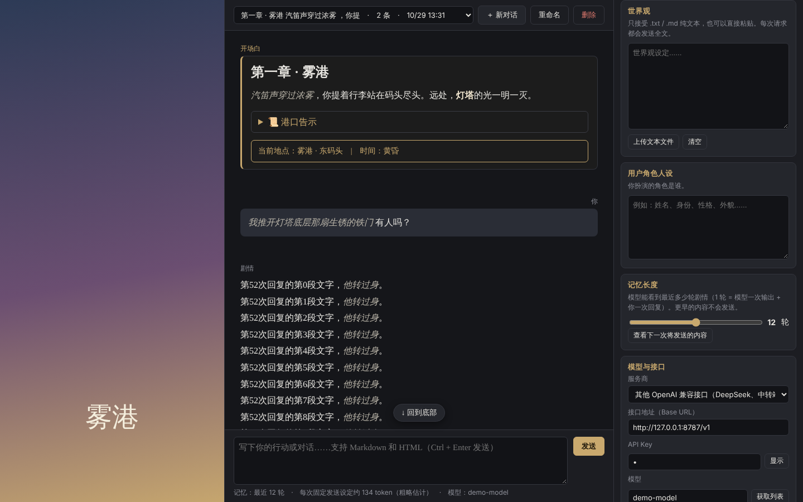

# Proteus

一个接入大语言模型（LLM）的角色扮演聊天工具，玩法类似 SillyTavern。有桌面版（Windows / macOS / Linux，自带浏览器内核）、安卓版和网页版。

界面支持简体中文、繁體中文、English、日本語（右侧设置最下方切换）。基于 GPL v3 开源；使用者需自备 API Key。



## 下载与安装

### 桌面版（推荐）

到 [Releases 页面](https://github.com/IonComan813/ProjectProteus/releases) 下载最新版本：

| 文件 | 说明 |
|---|---|
| `Proteus-Setup-版本号-win-x64.exe` | Windows 安装程序，装好后桌面和开始菜单会有快捷方式 |
| `Proteus-版本号-win-x64.zip` | Windows 免安装版，解压后双击 `Proteus.exe` |
| `Proteus-版本号-mac-arm64.dmg` | macOS，Apple 芯片（M1 及更新） |
| `Proteus-版本号-mac-x64.dmg` | macOS，Intel 芯片 |
| `Proteus-版本号-linux-x86_64.AppImage` | Linux 版，加上可执行权限后直接运行 |
| `Proteus-版本号-android.apk` | 安卓版（安卓 7.0 及以上），见下方说明 |

桌面版自带 Chromium 浏览器内核，不需要另外安装浏览器，和网页版相比还有这些好处：

- **没有跨域限制**：不允许浏览器直接访问的中转站也能正常使用
- **数据和浏览器分开保存**：不会被清理浏览器数据误删，其他网页也读不到 Proteus 的数据

> 安装程序没有经过付费的代码签名：
>
> - **Windows** 第一次运行可能弹出「Windows 已保护你的电脑」，点「**更多信息**」→「**仍要运行**」即可
> - **macOS** 第一次打开可能提示「无法验证开发者」，在「系统设置」→「隐私与安全性」底部点「**仍要打开**」即可

### 安卓版

在手机上下载 `Proteus-版本号-android.apk`，点击安装。第一次安装时，系统会要求允许浏览器（或文件管理器）"安装未知来源应用"，按提示打开即可。

- 界面是手机布局：艺术图作为调暗的背景，聊天区叠在上面；点右上角的 ⚙ 打开设置
- 导出剧情、世界卡和备份时会弹出系统的分享菜单，可以存到"文件"、网盘或发给别人
- 安卓版和网页版一样受浏览器的跨域限制：Claude、OpenAI、Gemini、OpenRouter 官方接口都能用，少数不允许浏览器访问的中转站用不了（这类中转站请用桌面版）
- 手机上的数据和电脑上的数据互不相通，可以用「完整备份（全部对话）」转移

### 网页版

不需要安装任何东西：

1. 下载整个文件夹（GitHub 页面上的 **Code → Download ZIP**，然后解压）
2. 双击 `index.html`，用 Chrome 或 Edge 打开即可

窗口宽度小于 1000 像素时（包括用手机浏览器打开）会自动切换为手机布局。

### 数据保存在哪里

所有数据（设定、对话、图片、API Key）都只保存在**这台电脑上**：桌面版保存在软件自己的数据文件夹里，网页版保存在打开它的浏览器里。桌面版和网页版的数据互不相通，可以用「完整备份（全部对话）」在两者之间转移。

换电脑、重装系统，或者（网页版）清除浏览器数据都会看不到原来的内容，所以请定期用右侧「导出 / 备份…」里的「完整备份（全部对话）」导出一份。

## 界面

| 区域 | 作用 |
|---|---|
| 左栏 | 艺术图。点击即可上传，推荐用竖版图片。图片按左栏宽度显示、不会被拉伸：比左栏高就裁掉上下两端，比左栏矮就上下留黑边。拖动左栏右边缘可以调整宽度（最宽约为窗口的 45%，并保证聊天区不被挤得太窄），双击边缘恢复默认 |
| 中栏 | 剧情区。顶部可以切换、新建、重命名、删除对话；底部是输入框，按 **Ctrl + Enter** 发送。拖动输入框上方的边缘可以调整输入框高度 |
| 右栏 | 设置，从上到下依次是：System Prompt → 世界观 → 用户角色人设 → 记忆长度 → 模型与接口 → 艺术图 → 导出与备份 → 本机数据 → 语言 |

### 每个对话的设定是独立的

**System Prompt、世界观、用户角色人设、开场白和艺术图属于各自的对话。** 点「新对话」时会复制当前对话的这几项（剧情清空），之后两边各改各的，互不影响；切回旧对话，看到的还是旧对话自己的设定。

记忆长度、模型与接口、API Key、界面语言和布局属于软件本身的设置，所有对话共用。

### 开场白

对话完全为空时，「发送」按钮下方会出现「添加开场白」按钮。点击后输入框变为编辑开场白，右侧按钮变成：

- **重载**：在聊天区显示渲染后的开场白预览，输入框内容不变（也可以按 Ctrl + Enter）。改了内容再点一次就会刷新预览
- **确认**：保存开场白并清空输入框，随后会询问开场白是否发送给模型
- **取消**：退出开场白编辑

开场白保存后显示在对话最上方。在发送第一条消息之前，可以直接在聊天区编辑或删除它；**对话开始后开场白就锁定了**，不能再编辑、删除，也不能更改是否发给模型（想换开场白请新建对话）。它下方有一个「发送给模型」勾选框（只有开场白有）：

- **勾选**：你之后发送的第一条消息会和开场白合在一起，作为第一条消息发给模型：
  ```
  【开场白】
  ……开场白内容……

  【用户】
  ……你的第一条消息……
  ```
  剧情推进到第一条消息超出记忆长度后，开场白也会随之超出，不再发送。
- **不勾选**：开场白只显示在聊天区，模型看不到它；你之后发送的第一条消息就是第一条消息。

开场白在导出剧情、世界卡和完整备份中都会保留。

### Markdown / HTML 美化

所有消息都会按 Markdown 和 HTML 显示，可以使用 `<details><summary>` 折叠块、自定义样式（`<style>`、`style="..."`）等。

- **开场白**还可以使用 JS（`<script>`）
- **之后的消息**（你的回复和模型的回复）禁用 JS，只用 Markdown、HTML、CSS 美化

每条消息都显示在一个独立的"沙箱"小窗口里，里面的样式和脚本只在这条消息内生效，不会影响聊天区以外的界面，也不会影响其他消息。开场白里的脚本也读不到本页面的任何数据（包括 API Key），不能让本页面跳转；但可以打开新窗口（桌面版会用系统浏览器打开网页）。

### 消息操作（鼠标移到消息上就会出现）

- **重新生成**：只出现在最后一条模型回复上。旧版本会保留，可以用 `‹ 2/3 ›` 来回切换
- **删除此版本**：消息有多个版本时，删掉当前显示的这个
- **编辑**：只能编辑**最近一次**的模型回复和**最近一次**的用户消息
  - 编辑模型回复：保存后不会重新生成，相当于你直接改写了剧情
  - 编辑用户消息：保存后自动按新内容重新生成回复（旧回复保留为另一个版本）
  - 更早的消息要修改，请先「回退」再改
- **回退到当前**：只出现在模型回复上。保留这条回复，删掉它之后的所有消息（最后一条回复上不可用）。想回到开场白，直接新建对话即可
- **复制**

模型生成期间可以随时往上滚动阅读，页面不会被强行拉回底部；想回到最新内容时，点「↓ 回到底部」。

## 每次发给模型的内容

```
[system]  System Prompt + 世界观全文 + 用户角色人设
[历史]    最近 N 轮剧情（N = 记忆长度，1–40 轮；1 轮 = 模型一次输出 + 你一次回复）
          如果开场白设为发送，且对话的第一条消息还在范围内，开场白会拼在它前面
[user]    你这一次的回复
```

更早的消息不会发送，模型也就"看不到"它们。剧情区里会用一条虚线标出记忆范围的分界，分界线以上的消息照常显示，只是模型看不到。
记忆长度可以直接输入数字，也可以点 − / ＋ 调整。输入框下方会显示下一次请求大约多少 token（粗略估计）。

## 导出与备份

右侧「导出与备份」里的「导出 / 备份…」可以选择：

| 选项 | 包含 | 不包含 |
|---|---|---|
| 剧情（TXT / Markdown） | 当前对话的开场白和全部消息 | System Prompt、世界观、人设、艺术图 |
| 世界卡（JSON，可加密） | 当前对话的 System Prompt、世界观、开场白（及是否发给模型）、艺术图 | 用户人设、剧情 |
| 完整备份（当前对话）（JSON，可加密） | 当前对话的全部内容：System Prompt、世界观、用户人设、开场白（及是否发给模型）、剧情（包括每条回复的所有版本）、艺术图 | 软件设置 |
| 完整备份（全部对话）（JSON，可加密） | 所有对话（各自的全部内容）和软件设置（记忆长度、模型与接口、界面语言、布局等） | API Key |

「读取世界卡 / 备份」支持世界卡和两种完整备份：

- **读取世界卡**：新建一个对话，使用卡里的 System Prompt、世界观、开场白和艺术图，用户人设为空；已有的对话完全不受影响
- **读取完整备份（当前对话）**：新建一个对话，内容和备份时一样；已有的对话完全不受影响（同一份备份读两次就是两个对话）
- **读取完整备份（全部对话）**：替换当前所有对话和设置（API Key 保留本机的不变），相当于把整个软件恢复到备份时的状态

图片在 JSON 里以文本形式（base64）保存，所以带图的世界卡和备份文件会比图片本身大约三分之一。艺术图也可以在右侧「艺术图」里单独下载。

### 加密世界卡（保护创作者的设定）

导出世界卡或完整备份时可以选择**加密**，并设置一个 4–16 位的密码（加密的完整备份里，剧情和用户人设是明文，只有下面那几项是密文）：

- 直接打开加密的文件，只能看到乱码
- 在 Proteus 中读取后，System Prompt、世界观、开场白和艺术图会被**锁定**：可以正常使用，但不能查看、修改、复制或下载；开场白照常显示，但不能编辑，也不能更改是否发给模型。用户人设和剧情不受影响
- 输入密码可以解锁，解锁后变回普通对话
- 从锁定的对话新建对话、再次导出世界卡或完整备份时，仍然保持加密，沿用原来的密码。导出前会提醒：再次读取时仍需要最初的密码才能解锁（这时不再询问是否加密；完整备份（全部对话）里的普通对话仍可以选择加密）
- **忘记密码将无法解锁**

> **加密的局限**：模型要使用这些设定，Proteus 就必须在本机解密并以明文发给模型接口；本项目又是开源的。所以加密只能防止直接查看文件和在软件中复制，**无法阻止有技术能力的人刻意获取内容**（例如查看发给模型的请求，或让模型复述设定）。

## 公用电脑

- 「模型与接口」里的「在这台电脑上记住 API Key」：取消勾选后，API Key 只在本次打开期间有效，关闭页面就会消失，不会写入本机
- 右侧「本机数据」里的「清除本机所有数据」：删除这个浏览器里 Proteus 保存的所有对话、设定、艺术图和 API Key

## 关于 API Key 的安全

Proteus 在使用者自己的电脑上运行，API Key 只保存在本机浏览器里，不会经过任何第三方服务器，导出的世界卡和备份里也不包含 Key。需要注意：

- （网页版）Chrome 里所有用双击方式打开的本地网页共用同一块存储空间，理论上一个恶意的本地 HTML 文件可以读到 Proteus 保存的数据。不要用同一个浏览器打开来路不明的 HTML 文件，或者改用桌面版——桌面版的数据和浏览器完全分开
- 别人分享的世界卡里，开场白可以带 JS。它运行在隔离的沙箱里，读不到 API Key 和你的数据，但可以加载外部图片等资源（也就能知道有人打开了这张卡）
- 网页版目前只在 Chrome / Edge 中测试过；Firefox、Safari 对本地网页的存储支持不稳定

## 支持的模型服务商

| 选项 | 说明 |
|---|---|
| Anthropic（Claude 官方） | 直接调用 Claude。已启用提示词缓存：世界观等固定内容会被缓存，后续请求更便宜、更快 |
| OpenAI 官方 | |
| Google Gemini | 使用 Gemini 的 OpenAI 兼容接口，在 [Google AI Studio](https://aistudio.google.com/) 申请 API Key 即可。免费额度下较大的模型经常繁忙（HTTP 503）或长时间无响应，所以默认用 `gemini-3.5-flash-lite`；遇到 503 时稍等再点「生成回复」或「重新生成」即可 |
| OpenRouter | 一个 Key 就能用很多家的模型。用 `anthropic/` 开头的 Claude 模型时同样会启用缓存 |
| 其他 OpenAI 兼容接口 | DeepSeek、各种中转站等。需要自己填写接口地址，通常以 `/v1` 结尾 |
| 其他 Anthropic 兼容接口 | 提供 Claude 原生格式的中转站 |

点击「获取列表」可以从接口拉取可用的模型名称，之后点模型输入框右侧的 ▾ 就能从列表里选择（也可以直接输入，输入时列表会按文字筛选）。获取到的列表会被记住。

### 关于 Claude 官方接口

- 使用最新的 API 版本。这个版本不接受 `temperature` 参数，所以 Anthropic 格式下没有这个选项，改为提供「思考深度（effort）」
- 新的 Claude 模型会先思考再输出，所以开头可能要等几秒，界面上会显示「模型思考中……」
- 对 `claude-opus-5-5`、`claude-sonnet-5-5` 等模型启用了官方的自动备用：如果请求被安全机制拦截，接口会自动换一个模型重试。如果最终仍被拒绝，界面上会显示提示

### 如果提示「无法连接到接口」

浏览器出于安全考虑，会拦截一部分直接访问外部接口的请求（"跨域限制"）。Claude 官方、OpenAI 官方、Gemini 和 OpenRouter 都允许浏览器直接访问；少数中转站不允许。**桌面版没有这个限制**，遇到这种情况请改用桌面版。

## 文件结构

```
index.html        页面结构
css/style.css     样式
js/i18n.js        界面多语言（简体中文、繁體中文、English、日本語）和默认 System Prompt
js/db.js          本地存储（浏览器的 IndexedDB）
js/crypto.js      世界卡加密
js/providers.js   和各家模型接口通信
js/render.js      消息显示（Markdown/HTML，沙箱隔离）
js/app.js         界面逻辑、对话管理、上下文拼装
js/vendor/        第三方库（marked：Markdown 解析，MIT 许可）
electron/main.js  桌面版入口（窗口、安全设置、解除跨域限制）
android/          安卓版工程（Capacitor），capacitor.config.json 是它的配置
assets/           安卓版图标和启动画面的原图
scripts/          打包用的小脚本
build/icon.png    应用图标
package.json      桌面版的依赖和打包配置
```

网页部分全部是普通的 HTML/CSS/JavaScript，不需要编译。桌面版用 [Electron](https://www.electronjs.org/) 把同一套网页和 Chromium 内核打包在一起；安卓版用 [Capacitor](https://capacitorjs.com/) 把同一套网页放进系统自带的 WebView。

### 自己打包桌面版

需要先安装 [Node.js](https://nodejs.org/)：

```bash
npm install
npm start            # 直接运行桌面版
npm run dist:win     # 打包 Windows 版（在 Linux 上打包需要安装 wine）
npm run dist:linux   # 打包 Linux 版
npm run dist:mac     # 打包 macOS 版（需要在苹果电脑上运行）
npm run android:apk  # 打包安卓版（需要安装 Android SDK 和 JDK 21）
```

打包结果在 `dist/` 文件夹里。

### 自动打包与发布（GitHub Actions）

仓库里的 `.github/workflows/build.yml` 会在 GitHub 的服务器上同时打包 Windows、Linux 和 macOS 版：

- **发布新版本**：在 GitHub 的 Releases 页面点「Draft a new release」，新建一个标签（例如 `v0.2.0`），填好标题和说明后点「Publish release」。大约 5 分钟后，各系统的安装包会自动上传到这个 Release，下载说明会接在你写的说明后面。版本号直接取自标签，**不需要改 `package.json`**。也可以用命令推送标签，效果相同：

  ```bash
  git tag v0.2.0
  ```

  ```bash
  git push origin v0.2.0
  ```

- **只想试试能不能打包**：在仓库的 Actions 页面选「Build desktop app」→「Run workflow」。只打包不发布，安装包在那次运行页面底部的 Artifacts 里，保留 30 天。

安装包里的下载说明来自 `.github/release-notes.md`。

#### 安卓版的签名密钥

安卓安装包必须签名，**而且以后每个版本都要用同一把密钥签名**，用户才能直接覆盖更新（否则只能先卸载，手机上的对话也会一起删掉）。签名密钥保存在仓库的 GitHub Secrets 里（Settings → Secrets and variables → Actions），需要两项：

| 名称 | 内容 |
|---|---|
| `ANDROID_KEYSTORE_BASE64` | 签名密钥文件（.jks）的 base64 文本 |
| `ANDROID_KEYSTORE_PASSWORD` | 密钥密码 |

密钥文件里的**别名（alias）必须是 `proteus`**，并且密钥密码和密钥库密码相同。没有密钥时可以这样生成一把（JDK 自带 `keytool`）：

```bash
keytool -genkeypair -v -keystore proteus.jks -alias proteus -keyalg RSA -keysize 2048 -validity 36500
```

没有设置时，「只打包不发布」的运行会改用临时的调试密钥签名（能安装，但以后无法覆盖更新），并在运行结果里给出警告；要发布到 Release 的运行会直接失败，避免把调试版发给用户。密钥文件和密码请另外妥善备份，**不要提交到仓库**。

#### 安卓冒烟测试

在 Actions 页面运行「Android smoke test」，会在 GitHub 的安卓模拟器里安装并打开应用，截图和日志在那次运行的 Artifacts 里。

## 多语言

切换界面语言时，除了界面文字，以下内容也会跟着变：

- 发给模型的标签：【世界观设定】【用户角色人设】【开场白】【用户】（英文为 `[World Setting]` `[User's Character]` `[Opening]` `[User]`，以此类推）
- 默认 System Prompt：如果当前对话的 System Prompt 没有改过（还是某种语言的默认内容），会换成新语言的默认内容；改过的不会动

世界观、人设、开场白等内容是使用者自己写的，不会被翻译。

## 许可

本项目基于 [GPL v3](LICENSE) 开源。使用者需自备 API Key，开发者不为使用者在本软件中的输入和输出承担法律责任。

第三方库：[marked](https://github.com/markedjs/marked)（MIT 许可）。
