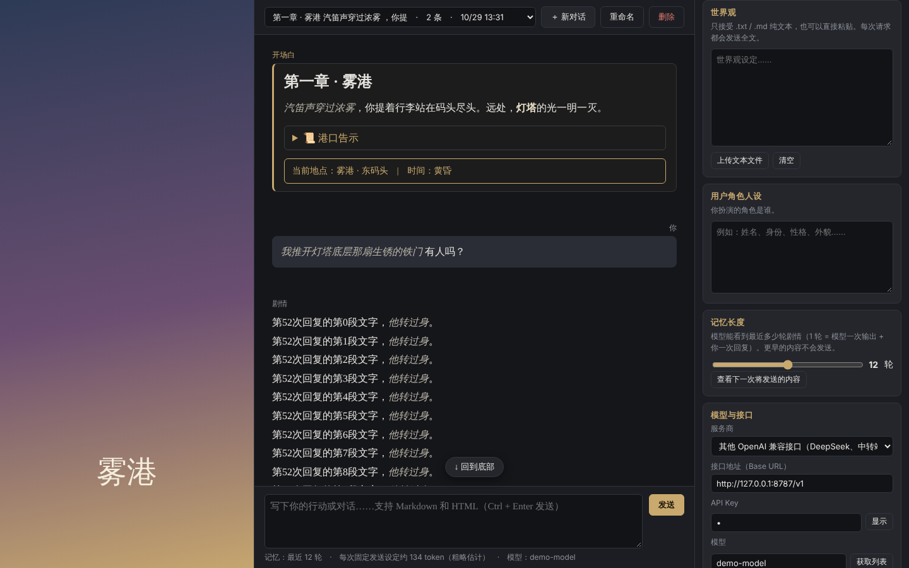

# Proteus

简体中文 | [English](README.md)

一个接入大语言模型（LLM）的角色扮演聊天工具，玩法类似 SillyTavern；也可以切换到[助理模式](#助理模式)，当作普通的 LLM 对话工具使用。有原生应用（Windows / macOS / Linux 和安卓）和网页版。

界面支持简体中文、繁體中文、English、日本語：第一次打开时按系统语言自动选择（不是这四种语言时显示英语），也可以随时在右侧设置的最下方切换（安卓版点右上角的 ⚙，滑到最下方）。基于 AGPL v3 开源；使用者需自备 API Key。



## 下载与安装

### 原生应用：Windows / macOS / Linux（推荐）

到 [Releases 页面](https://github.com/IonComan813/ProjectProteus/releases) 下载最新版本：

| 文件 | 说明 |
|---|---|
| `Proteus-Setup-版本号-win-x64.exe` | Windows 安装程序，装好后桌面和开始菜单会有快捷方式 |
| `Proteus-版本号-win-x64.zip` | Windows 免安装版，解压后双击 `Proteus.exe` |
| `Proteus-版本号-mac-arm64.dmg` | macOS，Apple 芯片（M1 及更新） |
| `Proteus-版本号-mac-x64.dmg` | macOS，Intel 芯片 |
| `Proteus-版本号-linux-x86_64.AppImage` | Linux 版，加上可执行权限后直接运行 |
| `Proteus-版本号-android.apk` | 安卓版（安卓 7.0 及以上），见下方说明 |

Windows / macOS / Linux 的原生应用自带 Chromium 浏览器内核，不需要另外安装浏览器，和网页版相比还有这些好处：

- **没有跨域限制**：不允许浏览器直接访问的中转站也能正常使用
- **数据和浏览器分开保存**：不会被清理浏览器数据误删，其他网页也读不到 Proteus 的数据

**开源协议**：海神Proteus 以 AGPL v3 发布。使用本软件不需要同意协议；修改或分发本软件，即视为同意协议（AGPL v3 第 9 条）。所以协议只作说明：Windows 安装程序第一页显示协议，点「下一步」继续（安装程序的界面语言跟随系统：简体中文、繁体中文、英文或日文，其他语言的系统显示英文）；免安装版、macOS、Linux、安卓版和网页版第一次打开时显示协议，点「我已知晓」后不再显示。有新版本时，更新提示在看完协议说明之后才显示。之后的更新不再显示协议。

> 原生应用没有经过付费的代码签名，安卓版也不是从应用商店下载的，第一次安装或打开时可能会看到提示：
>
> - **Windows** 第一次运行可能弹出「Windows 已保护你的电脑」，点「**更多信息**」→「**仍要运行**」即可
> - **macOS** 第一次打开可能提示「无法验证开发者」，在「系统设置」→「隐私与安全性」底部点「**仍要打开**」即可
> - **安卓** 安装时可能提示「出于安全考虑，已禁止安装未知来源的应用」（各品牌手机的说法略有不同），按提示允许浏览器（或文件管理器）「安装未知应用」，再回来点安装即可

### 原生应用：安卓

在手机上下载 `Proteus-版本号-android.apk`，点击安装。第一次安装时，系统会要求允许浏览器（或文件管理器）"安装未知来源应用"，按提示打开即可。

- 第一次打开时会显示开源协议，见上面的「开源协议」
- 界面是手机布局：艺术图作为调暗的背景，聊天区叠在上面；点右上角的 ⚙ 打开设置
- 返回键先关闭打开着的菜单、窗口或设置面板；没有可以关闭的时候，屏幕中间会提示「再按一次退出海神」，2 秒内再按一次才退出
- 导出剧情、世界卡和备份时会弹出系统的分享菜单，可以存到"文件"、网盘或发给别人
- 不允许浏览器直接访问的中转站（跨域限制）也能用：请求发不出去时，软件会改用安卓系统自己的网络连接重发，并记住这个接口地址。这类接口的回复要等全部生成完才一次性显示，不能边生成边显示。Claude、OpenAI、Gemini 官方接口和 OpenRouter 不受影响，照常边生成边显示
- 接口地址只能用 `https://`，不能用明文的 `http://`（例如局域网里的本地模型服务）
- 手机上的数据和电脑上的数据互不相通，对话可以用「完整备份（全部对话）」转移（软件设置和 API Key 不在备份里，要在另一边重新填）。安卓版的数据不会备份到 Google 账号，换手机时也不会自动带过去，请用完整备份转移

### 网页版

不需要安装任何东西：

1. 下载整个文件夹（GitHub 页面上的 **Code → Download ZIP**，然后解压）
2. 双击 `index.html`，用 Chrome 或 Edge 打开即可

输入框下方的声明里会注明这份网页版来自哪次提交：用 **Download ZIP**（或 Releases 页面上的「Source code」）下载的，显示提交编号和日期，正好是某个版本的提交时还会显示版本号，例如「（网页版 v0.4.0，提交 abc1234，2026-11-02）」。这些信息是 GitHub 生成压缩包时写进 `js/version.js` 的；用 `git clone` 得到的代码里没有，只显示「（网页版）」。

窗口宽度小于 1000 像素时（包括用手机浏览器打开）会自动切换为手机布局。

### 数据保存在哪里

所有数据（设定、对话、图片、API Key）都只保存在**这台设备上**：原生应用保存在应用自己的数据文件夹里，网页版保存在打开它的浏览器里。不同设备之间、原生应用和网页版之间的数据都互不相通，对话可以用「完整备份（全部对话）」转移，软件设置和 API Key 要在另一边重新填。

换电脑、重装系统，或者（网页版）清除浏览器数据都会看不到原来的内容，所以请定期用右侧「导出 / 备份…」里的「完整备份（全部对话）」导出一份。

### 检查更新

原生应用（电脑版和安卓版）启动时会从更新服务器检查有没有新版本。为了减少对服务器的请求，一天只检查一次：当天检查过、没有新版本时，当天再打开软件不再检查，第二天第一次打开时再检查（按日期算，不是满 24 小时）。连不上服务器时不算检查过，下次启动再试。

- 有新版本时提示，窗口里写着当前版本、新版本和新版本的更新内容。跳过了中间的版本时（例如从 0.4.6 直接更新到 0.5.1），最后会提示到 GitHub Release 页面查看那些版本的更新内容
- 按钮依次是「下载 vX」「一天后提醒」。不想现在更新时：
  - 「一天后提醒」：24 小时之内再打开软件都不提示，期间出了更新的版本也不提示。旁边的 ▾ 里还可以选「三天后提醒」（72 小时）
  - ▾ 里的「跳过此版本」：不再提示这个版本，出了更新的版本号时才再提示。跳过后同样是第二天才再检查
- 这个窗口必须选一个按钮：按 Esc 或点窗口外面都不会关闭
- 检查在启动时立刻进行，拿到版本信息、有要提示的版本就马上显示这个窗口。它盖在其他窗口和弹窗上面，选完后下面的东西保持原样；正在生成回复时也会显示，回复照常继续
- 选择下载后一路自动完成：在软件里下载（不问保存位置），屏幕中间显示进度条（版本号、百分比、已下载 / 总大小），周围变暗。下载和安装期间软件锁定，不能做别的操作，键盘也不起作用，进度条不能按 Esc 或点外面关掉，只能用鼠标（手机上用手指）点右边的 × 停止下载。下载完成后进度条那里显示「下载完成，正在启动安装程序…」，保存好对话后直接安装，不再询问。输入框里没发送的文字在安装后会放回去
- 下载完成后，当天不再检查（装好新版本后当天再打开也不检查）
- 安装程序被拦下、没能运行时不提示，软件照常运行
- 下载失败时弹出「下载失败」：下载被中断或超时，可能是网络问题或被安全软件拦截。连续 60 秒没有收到任何数据算超时；只是下载得慢、数据一直在来，不算超时。点了 × 时弹出「下载手动中止」。这两个窗口都必须选一个按钮：
  - 「再次检查更新」：重新读取版本信息，再显示一次更新提示
  - 「前往 GitHub Release 页面手动下载」：用浏览器打开这个版本的发布页面，当天不再检查
  - 「下次启动时再检查更新」：下次打开软件时再检查
- 下载的是这台设备对应的安装包（Windows 安装版 / 免安装版、Mac 的 Apple 芯片 / Intel 版、Linux、安卓分别对应），安装新版本后对话和设定会保留：
  - **Windows 安装版**：软件关闭，安装程序在后台静默安装到原来的文件夹（按第一次安装时选的位置和「只给自己 / 所有用户」），不再显示协议和选项页面，装好后自动打开新版本。装给「所有用户」的，Windows 仍会弹出一次管理员权限确认。安装包放在软件数据文件夹的 updates 里，下次启动时删掉。开源协议在第一次手动安装时已经同意过
  - **Linux（AppImage）**：用新版本替换正在用的 AppImage 文件（路径不变），打开新版本后关闭旧的
  - **macOS（dmg）**：安装包下载到「下载」文件夹，自动打开后软件关闭，把 Proteus 拖进「应用程序」替换旧版本
  - **Windows 免安装版（zip）**：下载到「下载」文件夹并打开所在文件夹，关闭软件后自己解压替换
  - **安卓版**：用系统的安装功能直接安装，安装时软件会关闭，装好后重新打开即可。安装包交给系统后马上删掉。第一次这样更新时，系统会要求允许海神「安装未知应用」并确认安装；安卓 12 及以上，之后的更新不再需要确认
- 只发布正式版。以前发布过的测试版（版本号带后缀，例如 `0.4.8-beta.1`）比同一个版本号的正式版旧，装着测试版的也会提示更新到新的正式版
- 连不上更新服务器时什么都不提示。网页版不检查更新

## 界面

| 区域 | 作用 |
|---|---|
| 左栏 | 艺术图。点击即可上传，推荐用竖版图片。图片按左栏宽度显示、不会被拉伸：比左栏高就裁掉上下两端，比左栏矮就上下留黑边。拖动左栏右边缘可以调整宽度（最宽约为窗口的 45%，并保证聊天区不被挤得太窄），双击边缘恢复默认 |
| 中栏 | 剧情区。顶部可以切换、新建、重命名、删除对话（点「＋ 新对话」会弹出菜单，选择新建「🎭 角色扮演」「🤖 助理模式」（见[助理模式](#助理模式)）或「🍺 酒馆兼容」对话（见[读取酒馆（SillyTavern）角色卡](#读取酒馆sillytavern角色卡)）；对话列表里每个对话名称前的 emoji 表示它的类型，还显示轮数和最近一次活动的时间：新建对话、保存开场白、向模型发出请求，按这个时间排序。展开列表后，左键切换到那个对话，右键（触屏上长按）可以重命名或删除它；列表里是最近活动的 9 个对话，更早的对话点最后一项「…」，在「全部对话」窗口里查看。电脑上，「全部对话」窗口里点一下只选中一个对话，再点一次或双击才切换过去（键盘按 Enter 直接切换）；触屏上点一下直接切换。「全部对话」窗口里可以一次删除多个对话：电脑上按住 Ctrl（Mac 上是 ⌘）点击逐个选中或取消，按住 Shift 点击选中一段，再右键任一选中的对话；触屏上勾选每行右边的方框，再长按任一勾选的对话。选中多个时菜单里只有删除；右键（长按）没有选中的对话时，原来选中的全部取消，只对这一个对话重命名或删除）；底部是输入框，按 **Ctrl + Enter** 发送。拖动输入框上方的边缘可以调整输入框高度 |
| 右栏 | 设置，从上到下依次是：System Prompt → 世界观 → NPC角色（含 `{{char}}` 值） → 用户角色人设（含 `{{user}}` 值） → 重点指令 → 记忆长度 → 模型与接口 → 艺术图 → 导出与备份 → 软件数据 → 语言 |

System Prompt、世界观和 NPC角色输入框下方有「放大窗口」：打开一个大的编辑窗口，方便输入和修改，内容和右侧的输入框同步；点窗口以外的地方（或按 Esc）关闭。电脑上它盖在聊天区上，手机布局里（点 ⚙ 打开的设置面板）盖在设置面板上。

「NPC角色」写世界里由模型扮演的其他角色，和世界观分开写更清楚；读取酒馆角色卡时，角色设定放在这里。它上方的单行输入框是 **`{{char}}` 值**（空着时提示「{{char}}值」），用法和下面的 [`{{user}}` 值](#user-值)一样：内容里的 `{{char}}` 在显示和发送时换成它，空着就原样保留；读取酒馆角色卡时自动填上角色名，可以改。它和 NPC角色一样算作设定：进世界卡，加密时一起加密。

### 每个对话的设定是独立的

**System Prompt、世界观、NPC角色、`{{char}}` 值、用户角色人设、`{{user}}` 值、重点指令、开场白（全部版本）和艺术图属于各自的对话。** 新建同一类型的对话时会复制当前对话的这几项（剧情清空），之后两边各改各的，互不影响；切回旧对话，看到的还是旧对话自己的设定。

记忆长度、模型与接口、API Key、界面语言和布局属于软件本身的设置，所有对话共用。

### `{{user}}` 值

用户角色人设上方的单行输入框（空着时提示「{{user}}值」）。设定、开场白和剧情里出现的 `{{user}}`（不区分大小写，酒馆角色卡里很常见）：

- **显示**：聊天区里显示成这里填的值（开场白、你的消息、模型回复都是），导出剧情时也一样
- **发送**：发给模型的所有内容里都换成这个值（System Prompt、世界观、NPC角色、人设、重点指令、开场白、剧情）
- **存储**：保存的内容里仍然是 `{{user}}`，所以改了值马上全部生效；System Prompt、世界观等编辑框里看到的也是 `{{user}}` 原文
- **留空**：原样显示、原样发送 `{{user}}`，模型一般能理解它指的是用户
- 内容里没有 `{{user}}` 时，这个值不起任何作用

它跟着对话走：新建对话时复制一份，进完整备份，但不进世界卡，也不加密；助理模式不使用。

### 重点指令（Post-History Instructions）

用户角色人设下方的输入块。这里写的内容会加在**你这一次发送的消息末尾**，是模型最后读到的内容，所以最容易被注意到：模型往往对开头和结尾印象深，容易忽略中间。适合写文风、篇幅、格式等提醒，例如「回复控制在 400 字以内，使用第三人称」。

- 留空时完全不发送，连标签也没有
- 只加在最新的那条用户消息上（重新生成时是那条回复前面的用户消息）；不会保存进消息里，之前的消息也不带它
- 和 System Prompt、世界观、NPC角色一样算作设定：进世界卡和完整备份，加密时一起加密；助理模式不使用

### 开场白

对话完全为空时，「发送」按钮下方会出现「添加开场白」按钮。点击后输入框变为编辑开场白，右侧按钮变成：

- **重载**：在聊天区显示渲染后的开场白预览，输入框内容不变（也可以按 Ctrl + Enter）。改了内容再点一次就会刷新预览
- **确认**：保存开场白并清空输入框，随后会询问开场白是否发送给模型
- **取消**：退出开场白编辑

开场白保存后显示在对话最上方。在发送第一条消息之前，可以直接在聊天区编辑或删除它；**对话开始后开场白就锁定了**，不能再编辑、删除，也不能更改是否发给模型（想换开场白请新建对话）。它下方有一个「发送给模型」勾选框（只有开场白有）：

- **勾选**：你之后发送的第一条消息会和开场白合在一起，作为第一条消息发给模型：
  ```
  【开场白】
  ……开场白内容……
  【开场白结束】

  【用户】
  ……你的第一条消息……
  ```
  剧情推进到第一条消息超出记忆长度后，开场白也会随之超出，不再发送。
- **不勾选**：开场白只显示在聊天区，模型看不到它；你之后发送的第一条消息就是第一条消息。

**多个开场白**：保存开场白后，开场白下方的按钮里有「新增」，可以再写一个开场白作为新的版本（同样用输入框编辑，「重载」预览，「确认」保存；不再询问是否发给模型，沿用原来的设置）。有多个版本时用 `‹ 2/3 ›` 切换；「编辑」和「删除此版本」只作用于当前显示的版本，只剩一个版本时就是「删除开场白」。**发出第一条消息时，当前显示的版本就定下来了**，之后不能再切换。读取酒馆角色卡时，卡里的备选开场白也会成为这里的版本。

开场白（全部版本）在世界卡和完整备份中都会保留；导出剧情时只包含当前版本。

### Markdown / HTML 美化

所有消息都会按 Markdown 和 HTML 显示，可以使用 `<details><summary>` 折叠块、自定义样式（`<style>`、`style="..."`）等。

- **开场白**还可以使用 JS（`<script>`）
- **之后的消息**（你的回复和模型的回复）禁用 JS，只用 Markdown、HTML、CSS 美化

每条消息都显示在一个独立的"沙箱"小窗口里，里面的样式和脚本只在这条消息内生效，不会影响聊天区以外的界面，也不会影响其他消息。开场白里的脚本也读不到本页面的任何数据（包括 API Key），不能让本页面跳转；但可以打开新窗口（Windows / macOS / Linux 的原生应用会用系统浏览器打开网页）。

### 消息操作（鼠标移到消息上就会出现）

- **发送后一个字回复都没有**（请求出错、被拦截，或者还没出字就点了停止）：刚发的消息退回输入框，对话回到上一次回复为止，改一改再点「发送」就是重试。输入框上方的红框说明原因（还没出字就停止的写「用户手动中断」；已经出了一部分再停止的不提示，看得出结尾是断的）
- **编辑用户消息后（或点「生成回复」）一个字回复都没有**：那条消息有多个版本，不退回输入框，留在原处；原因常驻显示在消息下方，切到别的版本再切回来也还在，提醒这个版本出了什么问题。点「生成回复」重试，得到回复后说明消失

- **重新生成**：只出现在最后一条模型回复上。旧版本会保留，可以用 `‹ 2/3 ›` 来回切换
- **编辑**：只能编辑**最近一次**的模型回复和**最近一次**的用户消息
  - 编辑模型回复：直接改当前这个版本，不会重新生成，相当于你直接改写了剧情
  - 编辑用户消息：存为这条消息的**新版本**，并按新内容生成回复；旧版本保留，可以用 `‹ 2/3 ›` 切换
  - 更早的消息要修改，请先「回退」再改
- **版本是分组的**：用户消息的每个版本各有自己的一组模型回复。比如消息 A 下有回复 B、C，改写成 A′ 后生成了 D、E：切换到 A 时回复只能在 B、C 之间切换，切换到 A′ 时只能在 D、E 之间切换
- **切换和删除版本**只在最后一组（最新的用户消息和最后一条模型回复）上可用，免得前后剧情接不上。更早消息的其他版本仍然保存着，「回退」到那里后又可以切换
- **删除此版本**：模型回复有多个版本时，删掉当前显示的这个
- **回退到当前**：只出现在模型回复上。保留这条回复，删掉它之后的所有消息（最后一条回复上不可用）。想回到开场白，直接新建对话即可
- **复制**

往上滚动时，聊天区顶部会出现「↑ 回到顶部」；往下滚动时，底部会出现「↓ 回到底部」。两个按钮按滚动方向出现，不会同时出现；已经在顶部（底部）时不显示。

模型生成期间可以随时往上滚动阅读，页面不会被强行拉回底部；想回到最新内容时，往下滚一点，再点「↓ 回到底部」。

## 助理模式

除了角色扮演，Proteus 也可以当作普通的 LLM 对话工具（个人助理）使用，接口和模型设置与角色扮演共用。

- **新建**：点聊天区上方的「＋ 新对话」，选「🤖 新建助理模式对话」
- **设定**：当前对话的开场白、System Prompt、世界观、用户人设和艺术图都不会带过来。System Prompt 换成通用的个人助理提示词（四种界面语言各有一份，可以修改）。「恢复默认」看当前对话的模式：角色扮演对话恢复角色扮演的默认提示词，助理对话恢复助理的默认提示词。这个模式不用世界观、NPC角色、用户人设、`{{user}}` 值和重点指令，右侧不显示这几项；没有「添加开场白」。艺术图照常可以上传，只用于显示，不发给模型（助理模式的对话也可以有自己的图片）
- **发给模型的**只有 System Prompt、记忆范围内的对话记录和你这一次的消息，不带世界观、NPC角色、人设、重点指令、开场白，也不带它们的标签（见下一节），`{{user}}` 也不替换。记忆长度照常可用
- **新建对话**：新建哪种对话都在「＋ 新对话」的菜单里选。新建的对话复制同一类型里最近使用的那个对话（就是当前对话时复制当前对话）：在助理模式的对话里选「🤖 新建助理模式对话」，沿用当前对话的 System Prompt 和艺术图；选「🎭 新建角色扮演对话」，设定、开场白和艺术图沿用最近使用的角色扮演对话，没有时用默认值。同样，在角色扮演对话里新建助理模式对话时，如果以前有助理模式的对话，会沿用最近那个的 System Prompt 和艺术图（角色扮演对话的艺术图不会带过去）
- **导出**：只有对话记录（TXT / Markdown）、完整备份（全部对话）和日志；世界卡和完整备份（当前对话）不显示。「读取世界卡 / 备份 / 酒馆卡」照常可用：世界卡、单个对话的备份和酒馆卡都读取为新对话，完整备份的对话加到现有对话里，与当前是什么模式无关
- **存储**：助理模式的对话和角色扮演对话格式相同，只多一个 `mode: "assistant"` 标记，所以会照常进入完整备份（全部对话）、照常读回。加密完整备份时，助理模式的对话和它的艺术图不加密（它没有需要保护的设定）

> 旧版本的 Proteus 读取含有助理模式对话的完整备份时，不认识这个标记，会把它们当作普通的角色扮演对话（System Prompt 是助理提示词，世界观和人设为空），内容不会丢。

## 每次发给模型的内容

每次请求由两部分组成：**系统设定**和**剧情记录**。下面说的就是实际发出的内容。发送之前可以点记忆长度下方的「查看下一轮将发送的内容」预览，发送之后可以在「导出 / 备份…」→「日志（最近一次请求）」里核对。

### 系统设定

依次是下面四段，段与段之间空一行；内容为空的段整段省略（连标签也没有）：

| 段 | 发出的样子 |
|---|---|
| System Prompt | 原文，不加标签 |
| 世界观 | 第一行是标签 `【世界观设定】`，下一行起是世界观全文 |
| NPC角色 | 第一行是标签 `【NPC角色】`，下一行起是 NPC角色全文 |
| 用户角色人设 | 第一行是标签 `【用户角色人设】`，下一行起是人设全文 |

Anthropic 格式（Claude 官方、Anthropic 兼容的中转站）放在请求的 `system` 字段里；OpenAI 格式（OpenAI 官方、Gemini、OpenRouter 和其他中转站）作为第一条 `system` 消息。

### 剧情记录

用户消息和模型回复交替排列：

- **范围**：最后一条是你这一次的消息（重新生成时，是这条回复前面的那条用户消息），再往前带上最近 N 轮。N 是记忆长度，1–40 轮；**1 轮 = 你的一条消息 + 模型对它的回复**。更早的消息不发送
- **版本**：每条消息只发送当前显示的版本，其他版本不发送
- **开场白**：不单独占一轮。设为「发送给模型」，并且对话的第一条消息还在范围内时，它和第一条消息合成一条用户消息：
  ```
  【开场白】
  ……开场白内容……
  【开场白结束】

  【用户】
  ……你的第一条消息……
  ```
  不发送开场白时，第一条消息原样发送，不加任何标签
- **重点指令**：有内容时加在最后一条用户消息（你这一次的消息）末尾：空一行，第一行是标签 `【重点指令】`，第二行是一句固定的说明（告诉模型这些是在叙事之外直接发给它的指令，不是你在剧情中的行动；界面上除了请求预览之外不显示），再下一行起是重点指令全文。没有内容时什么都不加
- **前情省略**：Anthropic 格式要求第一条必须是用户消息。如果截取后开头恰好是一条模型回复，前面会补一条内容为 `（前情省略）` 的用户消息。正常交替的剧情不会出现这种情况
- 万一出现连续两条同一角色的消息，会合并成一条（中间空一行），避免接口报错

以上所有内容（包括系统设定）里的 `{{user}}` 换成 [`{{user}}` 值](#user-值)，`{{char}}` 换成「NPC角色」上方的 `{{char}}` 值；值空着时原样保留。

### 例子

记忆长度为 1 轮，开场白设为发送，现在发出第 3 条消息：只带上前面的第 2 轮，第 1 轮已超出范围，开场白随第一条消息一起不再发送。

```
[system]     System Prompt
             （空行）
             【世界观设定】
             ……世界观……
             （空行）
             【NPC角色】
             ……NPC角色……
             （空行）
             【用户角色人设】
             ……人设……
[user]       第 2 条消息
[assistant]  第 2 条回复
[user]       第 3 条消息（这一次）
             （空行）
             【重点指令】
             如下为用户特别希望你注意和遵守的指令，……（固定的说明）
             ……重点指令……
```

没有重点指令时，最后四行不出现。如果记忆长度是 2 轮，第 1 轮也在范围内，发出的第一条用户消息就是上面那种带 `【开场白】……【用户】` 的样子。

### 标签的语言

标签跟随**发送时**的界面语言：

| | 简体中文 | 繁體中文 | English | 日本語 |
|---|---|---|---|---|
| 世界观 | `【世界观设定】` | `【世界觀設定】` | `[World Setting]` | `【世界観設定】` |
| NPC角色 | `【NPC角色】` | `【NPC角色】` | `[NPC Characters]` | `【NPCキャラクター】` |
| 用户角色人设 | `【用户角色人设】` | `【使用者角色設定】` | `[User's Character]` | `【ユーザーキャラクター設定】` |
| 开场白开头 | `【开场白】` | `【開場白】` | `[Opening]` | `【オープニング】` |
| 开场白结尾 | `【开场白结束】` | `【開場白結束】` | `[End of Opening]` | `【オープニングここまで】` |
| 第一条消息 | `【用户】` | `【使用者】` | `[User]` | `【ユーザー】` |
| 重点指令 | `【重点指令】` | `【重點指令】` | `[Key Instructions]` | `【重点指令】` |
| 前情省略 | `（前情省略）` | `（前情省略）` | `(Earlier story omitted)` | `（前略）` |

模型名、最大输出长度、思考深度或温度等参数取自「模型与接口」。

### 助理模式

只发送两部分，没有任何标签：

```
[system]     System Prompt（原文）
[user]       ……
[assistant]  ……
[user]       你这一次的消息
```

范围、版本、合并同一角色消息的规则和上面相同；没有开场白，世界观、NPC角色、人设和重点指令不发送，`{{user}}` 不替换。

### 记忆范围

更早的消息不会发送，模型也就"看不到"它们。剧情区里会用一条虚线标出记忆范围的分界，分界线以上的消息照常显示，只是模型看不到。
记忆长度可以直接修改框里的数字，也可以点 − / ＋ 调整。它下方会显示下一次请求大约多少 token，和下面窗口里的内容按同样的方法计算，与窗口顶部的总数一致：输入框里有文字时也算作你这一次的消息。

**token 估算会按实际用量自动校准**：一开始是粗略估计（中日韩文字约 1 字 1 token，其他约 4 个字符 1 token）。每次请求后，Proteus 读取接口报告的实际输入用量，自动修正以后的估算，不需要手动设置：

- 按中转站（接口地址）和中转站下的模型分别记录。不同中转站的同名模型、中转站和官方接口的同名模型分开计算；同一个中转站在两种兼容模式下的地址只差结尾的 `/v1` 时算作同一个中转站。在一个中转站里第一次用的模型，先沿用这个中转站其他模型的结果，但只作为起点：有了自己的数据以后各模型独立校准，在同一个中转站的几个模型之间来回切换不会互相拉动
- 稳定之后修正得慢一些：最近几次的估算误差（平滑后）在 5% 以内、并且至少有 5 次数据时算稳定，之后每次新数据对结果的影响从约 1/10 降到约 1/30，偏差不会被个别请求重新拉大；平滑误差超过 10%，或者连续两次往同一个方向差很多（情况真的变了，例如中转站换了上游），恢复正常速度并很快跟上
- 中日韩文字和其他文字分别校准（不同语言换算成 token 的比例不同），也会学到中转站额外加的固定开销
- 估算 = 各块之和 + 加值：每一块（system 的各部分和每条消息）是 a × 中日韩字数 + b × 其他文字的粗略估算（空的块是 0），加值是学到的固定开销 c（包括中转站自己加的内容和每条消息的格式开销）。在一个中转站里第一次用的模型，a、b、c 先沿用这个中转站其他模型的结果，所以还没发过请求也可能有加值。估算下方同时显示这个对话上一次请求发送时的输入 token 估值，以及接口报告的实际输入、输出 token 和偏差（（估值 − 实际）÷ 实际，负数是估少了）。回复中途断开或被停止时，接口可能没报告输出用量（这时写「未接收到输出 token 报告」），OpenAI 格式甚至整次都没有用量（写「上一次请求没收到接口报告的用量」）。请求出错、一个字都没有回复时，刚发的消息退回输入框，界面上没有这次请求，「上一次请求」仍然显示之前那一次
- 校准从第一次请求就开始逐步进行（没有数据时就是粗略估计），所以提示里一直写「逐步按照接口报告用量校准」。「查看下一轮将发送的内容」里每一块都乘了校准的系数，顶部写成「各块之和 + 加值 = 总数」，加值就是固定开销 c（例如中转站自己加的内容），可能是负数。只记录数字，不记录对话内容；「清除软件数据」时一起删除，「完整备份（全部对话）」里一起备份，换设备后接着用
- 读取用量：Anthropic 格式（官方和兼容的中转站）的输入用量是 `input_tokens` 加上写入、读取缓存的 token；OpenAI 格式（OpenAI 官方、Gemini 和兼容的中转站）是 `prompt_tokens`。OpenAI 格式的流式回复要在请求里加 `stream_options` 才会报告用量（Gemini 的 OpenAI 兼容接口也支持）。个别接口不认这个参数会报错，这时 Proteus 去掉它自动重发一次，并记住这个接口地址以后不再加；这样的接口如果也不报告用量，就一直显示粗略估计

**什么时候实际用量会和估算差得极远**：实际值不到粗略估算的 1/5，或者超过 50 倍时，这次的数字只显示出来，不用来校准。已经校准过（至少 3 次数据）的模型标准更严：和校准后的估算相差 3 倍以上的，第一次完全不计入；下一次又往同一个方向差很多时才认定情况变了、把它补上。这样的数字通常不是分词的差别（不同模型、不同语言的分词差别一般在几成以内），而是接口报告的方式有问题：

- **只报告了没命中缓存的部分**：最常见。命中缓存后，有的中转站把 Anthropic 格式转成 OpenAI 格式时只填了没命中缓存的 `input_tokens`（或者反过来漏掉了缓存的字段），几万 token 的请求看起来只有几十个
- **报告的是假数字**：固定的 0、1，或者和请求无关的固定值；有的号池、逆向渠道根本不按实际计数
- **报告的是计费额度而不是 token**：按「倍率」换算后的数字，可能是实际 token 的几十倍
- **接口改动了内容**：中转站截断或压缩了上下文（例如 OpenRouter 的 middle-out 压缩），实际处理的比发送的少很多

另外两种情况差别也很大，但数字是真实的，照常用来校准：

- **中转站偷偷加了很长的 system prompt**（例如用 Claude Code、Cursor 一类的账号转出来的渠道，常带上万 token 的提示词）：短对话的实际值会是估算的十几二十倍，这部分由固定开销 c 学到，对话越长占比越小
- **中转站用别的分词器计数**（例如一律用 OpenAI 的 tiktoken 给 Claude 计数）：差一两成到三四成，按中转站分开校准就是为了这个

### 共享 token 校准数据（目前关闭）

校准只在本机进行，不上传也不下载任何数据。以前做过一个在用户之间匿名共享校准系数的功能（服务器在 `worker/calibration`，客户端在 `js/tokens.js`），代码保留、目前关闭；打开的方法写在 `js/tokens.js` 开头。

## 导出与备份

右侧「导出与备份」里的「导出 / 备份…」可以选择：

| 选项 | 包含 | 不包含 |
|---|---|---|
| 剧情（TXT / Markdown） | 当前对话的开场白和全部消息 | System Prompt、世界观、NPC角色、人设、艺术图 |
| 对话记录（TXT / Markdown）（助理模式） | 当前对话的全部消息 | System Prompt |
| 世界卡（JSON，可加密） | 当前对话的 System Prompt、世界观、NPC角色、重点指令、开场白（全部版本及是否发给模型）、艺术图 | 用户人设、`{{user}}` 值、剧情 |
| 完整备份（当前对话）（JSON，可加密） | 当前对话的全部内容：System Prompt、世界观、NPC角色、用户人设、`{{user}}` 值、重点指令、开场白（全部版本及是否发给模型）、剧情（包括每条回复的所有版本）、艺术图 | 软件设置 |
| 完整备份（全部对话）（JSON，可加密） | 所有对话（各自的全部内容，和「完整备份（当前对话）」一样）和 token 校准数据（读取时和本机的合并） | 软件设置（记忆长度、模型与接口、API Key、界面语言、布局等） |
| 日志（TXT） | 最近一次请求模型时实际发送的请求（接口地址、请求头、JSON 请求体）和收到的原始回复，用于排查问题。只记这次打开软件以来的最后一次，不保存 | API Key；加密世界卡里还没解锁的设定（显示为「受保护的内容」） |

助理模式的对话里只显示对话记录、完整备份（全部对话）和日志，见[助理模式](#助理模式)。

「读取世界卡 / 备份 / 酒馆卡」支持世界卡、两种完整备份，以及酒馆的角色卡和世界书（见[读取酒馆（SillyTavern）角色卡](#读取酒馆sillytavern角色卡)）。在助理模式的对话里也可以读取：

- **读取世界卡**：新建一个对话，使用卡里的 System Prompt、世界观、NPC角色、重点指令、开场白和艺术图，用户人设和 `{{user}}` 值为空；已有的对话完全不受影响
- **读取完整备份（当前对话）**：新建一个对话，内容和备份时一样；已有的对话完全不受影响（同一份备份读两次就是两个对话）
- **读取完整备份（全部对话）**：备份里的对话加到现有对话里，现有的对话不变。和现有对话相同的也会加进来（例如同一份备份读了两次，就会有两份），不需要的自己删除。软件设置不在备份里，读取时也不动（以前的版本做的备份里带着设置的，读取时也不用），读完后仍停在读取前的对话里。换设备时用它把对话搬过去，软件设置在新设备上重新调一次

图片在 JSON 里以文本形式（base64）保存，所以带图的世界卡和备份文件会比图片本身大约三分之一。艺术图也可以在右侧「艺术图」里单独下载。

### 加密世界卡（保护创作者的设定）

导出世界卡或完整备份时可以选择**加密**，并设置一个 4–16 位的密码（加密的完整备份里，剧情和用户人设是明文，只有下面那几项是密文）：

- 直接打开加密的文件，只能看到乱码
- 在 Proteus 中读取后，System Prompt、世界观、NPC角色、重点指令、开场白和艺术图会被**锁定**：可以正常使用，但不能查看、修改、复制或下载；开场白照常显示，但不能编辑、新增或删除版本，也不能更改是否发给模型（有多个版本时，对话开始前仍可以切换）。用户人设、`{{user}}` 值和剧情不受影响
- 输入密码可以解锁，解锁后变回普通对话
- 从锁定的对话新建对话、再次导出世界卡或完整备份时，仍然保持加密，沿用原来的密码。导出前会提醒：再次读取时仍需要最初的密码才能解锁（这时不再询问是否加密；完整备份（全部对话）里的普通对话仍可以选择加密）
- **忘记密码将无法解锁**
- **酒馆兼容对话不能加密**：导出它的世界卡或完整备份时不询问是否加密，直接导出明文；加密完整备份（全部对话）时，它们和助理模式的对话一样保持明文。酒馆卡是酒馆作者的作品，作者发布时没有锁定，不应由读卡的人加上锁。自己写的设定请用角色扮演对话

> **加密的局限**：模型要使用这些设定，Proteus 就必须在本机解密并以明文发给模型接口；本项目又是开源的。所以加密只能防止直接查看文件和在软件中复制，**无法阻止有技术能力的人刻意获取内容**（例如查看发给模型的请求，或让模型复述设定）。

## 读取酒馆（SillyTavern）角色卡

Proteus 可以读取酒馆的角色卡和世界书，读取后的对话是**酒馆兼容对话**（对话列表里名称前是 🍺）。只支持读取，不能导出成酒馆格式。

有两种读取方式：

- 右侧「读取世界卡 / 备份 / 酒馆卡」
- 「＋ 新对话」菜单里的「🍺 新建酒馆兼容对话」：在酒馆兼容对话里选它，会新建一个酒馆兼容对话，复制当前对话的全部设定（剧情除外）；在其他对话里选它，会提示先读取酒馆的文件，然后选择角色卡或世界书（这里只接受酒馆的文件）

支持的文件：

- **PNG 角色卡**（V1 / V2 / V3），图片本身用作艺术图
- **JSON 角色卡**
- **单独的世界书**（JSON，酒馆或 Chub 导出的世界书）
- 不支持 V3 的 CHARX（zip）格式

### 一个对话里最多一个世界书、一个角色

角色卡可能自带世界书，也可能不带；单独的世界书里不会有角色。所以一个酒馆兼容对话可以由「世界书 + 角色卡」组成，按任意顺序读取。读取到哪里按下面的规则：

| 当前对话 | 读取世界书 | 读取角色卡 |
|---|---|---|
| 不是酒馆兼容对话，或已经开始聊天（发出过消息；只保存了开场白不算），或是锁定的 | 新建对话 | 新建对话 |
| 只有世界书 | 新建对话（两个世界观不能放在同一个对话里） | **加入当前对话** |
| 只有角色卡（不带世界书） | **加入当前对话** | 不支持群聊：问是否新建对话（需要世界书的话，在新对话里再读取） |
| 世界书 + 角色卡（包括角色卡自带的世界书） | 新建对话 | 同上 |

自带世界书的角色卡不能加入已经有世界书的对话，会新建对话。新建对话时，用户人设和 `{{user}}` 值为空，已有的对话不受影响。

世界书放进「世界观」，角色设定放进「NPC角色」。加入当前对话时会**覆盖**对应的那一栏；那一栏里已经有内容（你自己写的）时，会先问是否覆盖。开始聊天后读取的设定可能和已有的剧情冲突，所以一律新建对话。

### 角色卡的内容放在哪里

| 酒馆字段 | Proteus |
|---|---|
| 名称（`name`） | 新建对话时作为对话标题；填进 `{{char}}` 值（可以改），对话里所有 `{{char}}` 在显示和发送时换成它 |
| 图片 | 艺术图（加入当前对话时，当前对话没有艺术图才用它） |
| System Prompt（`system_prompt`） | System Prompt。卡里写了 `{{original}}` 的地方换成原来的 System Prompt（作者在它的基础上追加）。新建对话时，卡里没有就用默认值。加入当前对话时，当前的 System Prompt 还是默认内容就直接用卡里的；你改过的话会先问是否覆盖，弹窗里显示将要改成的内容 |
| 内嵌世界书（`character_book`） | 「世界观」（全文） |
| 描述、性格、场景、对话示例 | 「NPC角色」：以「角色：名字」为标题，各项各有一个小标题 |
| 开场白（`first_mes`）和备选开场白（`alternate_greetings`） | 开场白的各个版本，勾选「发送给模型」。加入当前对话时，加在已有的开场白版本后面 |
| `post_history_instructions` | 重点指令（其中的 `{{original}}` 去掉）。加入当前对话时，当前的重点指令是空的就直接用；有内容的话先问是否覆盖 |
| 作者备注（`creator_notes`） | 不发给模型，读取后显示一次 |
| 标签、作者、版本、扩展字段（正则脚本等） | 忽略 |

单独的世界书全文放进「世界观」。

**世界书**：酒馆按关键词触发世界书条目，只把命中的条目发给模型；**Proteus 不按关键词触发，而是把全文放进世界观，每次请求都发送**。读取时会提示条目数和大约的 token 数。禁用的条目跳过；常驻条目排在前面，其余按插入顺序排列；有名称（或备注）的条目以名称作小标题。

### 宏

- `{{char}}`：保留在内容里，显示和发送时换成「NPC角色」上方的 `{{char}}` 值；读取角色卡时这个值自动填上角色名，空着时原样保留。所以先读取世界书、再加入角色卡，世界书里的 `{{char}}` 也会生效
- `{{user}}`：保留，显示和发送时换成 [`{{user}}` 值](#user-值)
- `{{// …}}`（作者注释）：读取时删掉
- 老卡里的 `<USER>` 当作 `{{user}}`，`<BOT>`、`<CHAR>` 当作 `{{char}}`
- 其他宏（例如 `{{random:…}}`）和对话示例里的 `<START>` 保持原样

酒馆兼容对话导出的世界卡和完整备份会带上这个标记（以及角色名、世界书名），读回来仍是酒馆兼容对话。

依赖酒馆专有功能（正则脚本、STscript、前端扩展等）的卡，这部分效果不会生效；模型直接输出的 HTML 状态栏照常显示。

## 公用设备

- 「模型与接口」里的「在这台设备上记住 API Key（全局设置）」（添加服务商的窗口里也有同一个勾选框）：取消勾选后，所有服务商的 API Key 都只在本次打开期间有效，关闭页面就会消失，不会写入本机
- 右侧「软件数据」里的「清除软件数据」：删除当前软件保存的所有对话、设定、艺术图和 API Key。网页版的数据存在打开它的浏览器里，和原生应用分开存储，清除一边不影响另一边（点按钮后的确认弹窗里，会在当前所用的那一边后面标上「（本软件）」）

## 关于 API Key 的安全

Proteus 在使用者自己的设备上运行，API Key 只保存在本机的软件数据中（网页版是浏览器的存储），不会经过任何第三方服务器，导出的世界卡和备份里也不包含 Key。需要注意：

- （网页版）Chrome 里所有用双击方式打开的本地网页共用同一块存储空间，理论上一个恶意的本地 HTML 文件可以读到 Proteus 保存的数据。不要用同一个浏览器打开来路不明的 HTML 文件，或者改用原生应用——原生应用的数据和浏览器完全分开
- 别人分享的世界卡里，开场白可以带 JS。它运行在隔离的沙箱里，读不到 API Key 和你的数据，但可以加载外部图片等资源（也就能知道有人打开了这张卡）
- 网页版目前只在 Chrome / Edge 中测试过；Firefox、Safari 对本地网页的存储支持不稳定

## 支持的模型服务商

| 选项 | 说明 |
|---|---|
| Anthropic（Claude 官方） | 直接调用 Claude |
| OpenAI 官方 | |
| Google Gemini | 使用 Gemini 的 OpenAI 兼容接口，在 [Google AI Studio](https://aistudio.google.com/) 申请 API Key 即可。免费额度下较大的模型经常繁忙（HTTP 503）或长时间无响应，建议先用 `gemini-3.5-flash-lite` 这类小模型；遇到 503 时稍等再点「生成回复」或「重新生成」即可 |
| ＋ 添加服务商… | OpenRouter、DeepSeek、各种中转站等，可以添加任意多个。在弹出的窗口里填名称（随意起）、选兼容模式（OpenAI 兼容：大多数中转站；Anthropic 兼容：提供 Claude 原生格式的少部分中转站）、填接口地址（OpenAI 兼容的通常以 `/v1` 结尾，OpenRouter 是 `https://openrouter.ai/api/v1`）和 API Key，可以点「获取模型列表」测试并选一个模型。获取成不成功都可以保存，至少要填名称、兼容模式和接口地址。这个窗口按 Esc 或点窗口以外的地方不会关闭（免得丢掉填好的内容），只能点「取消」或「保存」。保存后它出现在服务商列表里；之后在「模型与接口」里改它的名称、兼容模式、地址、Key 或模型都会自动保存，也可以删除它 |

以前版本的「其他 OpenAI 兼容格式」「其他 Anthropic 兼容格式」填过的设置，升级后各自变成一个添加的服务商，名称是接口地址的域名。

点击「获取列表」可以从接口拉取可用的模型名称，之后点模型输入框右侧的 ▾ 就能从列表里选择（也可以直接输入，输入时列表会按文字筛选）。获取到的列表会被记住。

### 关于 Claude 官方接口

- 使用最新的 API 版本。这个版本不接受 `temperature` 参数，所以 Anthropic 格式下没有这个选项，改为提供「思考深度（effort）」
- 新的 Claude 模型会先思考再输出，所以开头可能要等几秒，界面上会显示「模型思考中……」
- 对 `claude-opus-5-5`、`claude-sonnet-5-5` 等模型启用了官方的自动备用：如果请求被安全机制拦截，接口会自动换一个模型重试。如果最终仍被拒绝，界面上会显示提示

### 流式和非流式回复

请求时总是要求流式回复（文字边生成边显示）。个别中转站不支持流式、直接返回一整段完整回复时，也能正常读取，只是要等全部生成完才一次性显示。

如果提示「模型没有返回任何内容」，可以在「导出 / 备份…」里导出日志，看看接口实际返回了什么（例如有的中转站把正文放进了思考内容里，软件无法区分）。

### 如果提示「无法连接到接口」

浏览器出于安全考虑，会拦截一部分直接访问外部接口的请求（"跨域限制"）。Claude 官方、OpenAI 官方、Gemini 和 OpenRouter 都允许浏览器直接访问；少数中转站不允许。**原生应用没有这个限制**，遇到这种情况请改用它（安卓版上这类接口的回复会等全部生成完才一次性显示）。

## 文件结构

```
index.html        页面结构
css/style.css     样式
js/i18n.js        界面多语言（简体中文、繁體中文、English、日本語）和默认 System Prompt
js/db.js          本地存储（浏览器的 IndexedDB）
js/crypto.js      世界卡加密
js/tokens.js      token 估算，按接口报告的实际用量自动校准
js/providers.js   和各家模型接口通信
js/render.js      消息显示（Markdown/HTML，沙箱隔离）
js/stcard.js      读取酒馆（SillyTavern）的角色卡和世界书
js/update.js      原生应用启动时检查更新
js/version.js     网页版的版本信息（用 Download ZIP 下载时由 GitHub 填入）
js/app.js         界面逻辑、对话管理、上下文拼装
js/vendor/        第三方库（marked：Markdown 解析，MIT 许可，许可证全文在 marked.LICENSE.md）
electron/main.js  Windows / macOS / Linux 原生应用的入口（窗口、安全设置、解除跨域限制、下载更新）
electron/preload.js  给页面提供的原生功能（目前只有下载和安装更新）
android/          安卓版工程（Capacitor），capacitor.config.json 是它的配置；UpdateDownloaderPlugin.java 在软件里下载并安装更新（UpdateInstallReceiver.java 处理需要用户确认的情况）
assets/           安卓版图标和启动画面的原图
scripts/          打包用的小脚本（包括检查第三方许可证、生成第三方声明的 third-party-notices.js）
worker/calibration/  共享 token 校准数据的服务器（Cloudflare Worker + R2；共享功能目前关闭，不需要部署）
build/icon.png    应用图标
package.json      依赖，以及 Windows / macOS / Linux 原生应用的打包配置
```

网页部分全部是普通的 HTML/CSS/JavaScript，不需要编译。Windows / macOS / Linux 的原生应用用 [Electron](https://www.electronjs.org/) 把同一套网页和 Chromium 内核打包在一起；安卓版用 [Capacitor](https://capacitorjs.com/) 把同一套网页放进系统自带的 WebView。

### 自己打包原生应用

需要先安装 [Node.js](https://nodejs.org/)：

```bash
npm install
npm start            # 直接运行（Windows / macOS / Linux 原生应用）
npm run dist:win     # 打包 Windows 版（在 Linux 上打包需要安装 wine）
npm run dist:linux   # 打包 Linux 版
npm run dist:mac     # 打包 macOS 版（需要在苹果电脑上运行）
npm run android:apk  # 打包安卓版（需要安装 Android SDK 和 JDK 21）
```

打包结果在 `dist/` 文件夹里。

### 自动打包与发布（GitHub Actions）

仓库里的 `.github/workflows/build.yml` 会在 GitHub 的服务器上同时打包 Windows、Linux 和 macOS 版：

- **发布新版本**：在 GitHub 的 Releases 页面点「Draft a new release」，新建一个标签（例如 `v0.2.0`），填好标题和说明后点「Publish release」。大约 5 分钟后，各系统的安装包会自动上传到这个 Release，下载说明会接在你写的说明后面。版本号直接取自标签，**不需要改 `package.json`**。也可以用命令推送标签，效果相同：

  ```bash
  git tag v0.2.0
  ```

  ```bash
  git push origin v0.2.0
  ```

- **不在本机打标签也能发布**：在 Actions 页面运行「Tag and release」（`.github/workflows/release-tag.yml`），选好分支（一般是 `main`），填写版本标签（例如 `v0.5.1`）。它在那个分支的最新提交上打标签，再启动打包工作流发布这个版本，结果和推送标签一样

- **测试版**（目前不用：只发布正式版，软件也只检查正式版）：用带后缀的标签，例如 `v0.4.0-beta.1`，打在要测试的那次提交上，可以是任何分支（在「Draft a new release」页面把「Target」选成那个分支）。这样的标签新建的 Release 会标为**预发布（Pre-release）**：不会成为「最新版本（Latest）」，说明开头会注明是测试版（在网页上自己新建 Release 时也一样）。想给某个版本写专门的说明，在那次提交里加上 `.github/release-notes/<标签>.md`（例如 `v0.4.0-beta.1.md`），它会放在 Release 说明的最前面。安卓版里 `0.4.0-beta.1` 和 `0.4.0` 的版本号（versionCode）相同，所以正式的 `0.4.0` 可以直接覆盖更新它；但之后发布的更低版本（例如 `0.3.4`）不能装在它上面
- **只想试试能不能打包**：在仓库的 Actions 页面选「Build native app」→「Run workflow」。只打包不发布，安装包在那次运行页面底部的 Artifacts 里，保留 30 天。

**更新说明**：仓库里的 `.github/next-release.md` 记着上一个版本以来、用户能感觉到的改动，每条四种语言放在一起，例如：

```
基准版本: v0.5.0

- zh-CN: 修复了特定窗口无法按照预期关闭的问题
  zh-TW: 修復了特定視窗無法按照預期關閉的問題
  en: Fixed some windows not closing as expected
  ja: 一部のウィンドウが想定どおりに閉じない問題を修正しました
```

- **每个 PR 都要维护这个文件**：加入这次的条目；和以前的条目冲突的（例如这次改掉、撤销了以前加的功能），删掉或改成最新的说法。这样到发布时，文件里就是干净准确的这个版本的更新说明
- **只改了后台逻辑的 PR 建议也写一条**：简短的说明，不展开，例如「优化了一些后台逻辑」。否则两个版本之间只有这样的 PR 时，更新说明是空的，用户看不出更新了什么。已经有这样一条时不用重复加；这只是建议，检查不强制
- **发布新版本后的第一个 PR**：清空文件里的条目，把「基准版本」改成刚发布的版本
- **PR 正文的开头**必须有这样一段，第二行写一句做了什么即可。条目没有变化时写「- 无需更新」：

  ```
  ## 更新说明文件
  - 已更新：加入 1 条；删去和它冲突的「……」
  ```

- **PR 检查**（`.github/workflows/pr-notes-check.yml`）会核对：
  - 改了条目（加、删、改）就要写「已更新」，没改就要写「无需更新」。只清空已经发布的条目、改基准版本，或者只改注释，不算改了条目：发版后的第一个 PR 只做了清空时写「无需更新」，清空之后又加了这次的条目时写「已更新」；
  - 文件格式正确，每一条都有 zh-CN、zh-TW、en、ja 四种语言；
  - 基准版本是最新发布的版本。不是的话说明刚发布过版本、还没清空，检查不通过，并提示怎么改；
  - 文件里一条都没有时只给出提醒（发布时更新说明会是空的），不算失败。

  格式细节见 `scripts/release-notes.js` 开头的说明。PR 正文的其他部分写详细的改动说明，不再收集。
- **发布时**：打包工作流读取这次提交里的这个文件，中英双语的一段放在 Release 说明的最前面，四种语言的写进更新服务器上的 `version.json`。`version.json` 只记最新这个版本的说明，另外记下上一个版本的版本号：软件提示更新时显示这个版本的说明，用户跳过了中间的版本时，提示到 GitHub Release 页面查看

Release 页面上的下载说明来自 `.github/release-notes.md`（英文）。Release 说明的最后会自动写上「The installers on this page were built from commit xxx」（本页安装包构建自哪次提交），用所选分支重新打包、替换已有 Release 的安装包时也会更新这一行，源代码以这次提交为准。

每次打包前会先检查打进安装包的第三方组件的许可证（`scripts/third-party-notices.js`）：遇到不认识或和 AGPL v3 不兼容的许可证时打包失败，需要人工确认后在脚本里登记；通过后生成 `THIRD_PARTY_NOTICES.txt` 放进安装包。

#### 安卓版的签名密钥

安卓安装包必须签名，**而且以后每个版本都要用同一把密钥签名**，用户才能直接覆盖更新（否则只能先卸载，手机上的对话也会一起删掉）。签名密钥保存在仓库的 GitHub Secrets 里（Settings → Secrets and variables → Actions），需要两项：

| 名称 | 内容 |
|---|---|
| `ANDROID_KEYSTORE_BASE64` | 签名密钥文件（.jks）的 base64 文本 |
| `ANDROID_KEYSTORE_PASSWORD` | 密钥密码 |

密钥文件里的**别名（alias）必须是 `proteus`**，并且密钥密码和密钥库密码相同。没有密钥时可以这样生成一把（JDK 自带 `keytool`）：

```bash
keytool -genkeypair -v -keystore proteus.jks -alias proteus -keyalg RSA -keysize 2048 -validity 36500
```

没有设置时，「只打包不发布」的运行会改用临时的调试密钥签名（能安装，但以后无法覆盖更新），并在运行结果里给出警告；要发布到 Release 的运行会直接失败，避免把调试版发给用户。密钥文件和密码请另外妥善备份，**不要提交到仓库**。

#### 更新服务器（Cloudflare R2）

发布到 Release 之后，工作流会把同一批安装包和一个 `version.json` 上传到 Cloudflare R2 的存储桶 `projectproteus-releases`，软件启动时从那里检查更新（`js/update.js`）。版本放在 `stable/`，只保留最新的一个版本；重新打包一个比现有版本旧的标签时保持不变。（带后缀的测试版标签会放在 `beta/`，但软件现在只检查 `stable/`。）

需要先做三件事：

1. 在 Cloudflare 的 R2 → 存储桶 → Settings 里开启公开访问：**Public Development URL**（`https://pub-….r2.dev`，有限速，官方说明只适合测试），或者绑定一个托管在 Cloudflare 上的自己的域名（**Custom Domains**）
2. 在 R2 → Manage API tokens 里创建一个令牌，权限选「Object Read & Write」，只给这个存储桶
3. 在仓库 Settings → Secrets and variables → Actions 里添加：

| 类型 | 名称 | 内容 |
|---|---|---|
| Secret | `R2_ACCESS_KEY_ID` | 令牌的 Access Key ID |
| Secret | `R2_SECRET_ACCESS_KEY` | 令牌的 Secret Access Key |
| Variable | `UPDATE_BASE_URL` | 第 1 步得到的公开地址，结尾不带 `/` |

没有添加两个 Secret 时，跳过上传，只给出警告；没有 `UPDATE_BASE_URL` 时，打出的安装包不检查更新（打包时由 `scripts/set-server-url.js` 把地址写进 `js/update.js`）。

#### 共享校准数据的服务器（Cloudflare Worker，目前不用）

共享 token 校准数据的功能目前关闭（见[共享 token 校准数据（目前关闭）](#共享-token-校准数据目前关闭)），**不需要部署这个 Worker，也不需要在 Cloudflare 上做任何设置**。代码在 `worker/calibration`，部署用的工作流是 `.github/workflows/calibration-worker.yml`（只能手动运行），需要的 Secret / Variable 写在工作流开头。

#### 安卓冒烟测试

在 Actions 页面运行「Android smoke test」，会在 GitHub 的安卓模拟器里安装并打开应用，截图和日志在那次运行的 Artifacts 里。

## 多语言

没有手动选过界面语言时，软件按系统语言自动选择：Windows / macOS / Linux 原生应用看操作系统的语言，安卓版看手机的系统语言，网页版看浏览器的语言。不是简体中文、繁體中文、English、日本語之一时显示英语。在设置里手动选过之后，以后都用你选的语言。

切换界面语言时，除了界面文字，以下内容也会跟着变：

- 发给模型的标签：【世界观设定】【NPC角色】【用户角色人设】【开场白】【开场白结束】【用户】（英文为 `[World Setting]` `[NPC Characters]` `[User's Character]` `[Opening]` `[End of Opening]` `[User]`，以此类推）
- 默认 System Prompt：如果当前对话的 System Prompt 没有改过（还是某种语言的默认内容），会换成新语言的默认内容；改过的不会动

世界观、人设、开场白等内容是使用者自己写的，不会被翻译。

## 许可

本项目基于 [AGPL v3](LICENSE)（GNU Affero 通用公共许可证第 3 版）开源。使用者需自备 API Key，开发者不为使用者在本软件中的输入和输出承担法律责任。

AGPL v3 在 GPL v3 的基础上多了一条：修改了本软件并通过网络向他人提供使用（例如部署成网站或在线服务）时，也必须向这些用户提供修改后的完整源代码。界面底部的项目网址就是向用户提供源代码的入口；对外提供修改版时，请把它（`js/i18n.js` 里的 `PROJECT_URL`）改成你的修改版源代码所在的地址。

此前已经发布的版本（v0.2.1 及更早）以 GPL v3 授权，仍然按 GPL v3 使用。

第三方组件和它们的许可证：

- 网页部分（所有版本）：[marked](https://github.com/markedjs/marked)（MIT）
- Windows / macOS / Linux 原生应用：[Electron](https://www.electronjs.org/)（MIT）及其包含的 Chromium 组件
- 安卓原生应用：[Capacitor](https://capacitorjs.com/)（MIT）、Apache Cordova、AndroidX、Kotlin 等（Apache-2.0）

完整清单和许可证全文在安装包里的 `THIRD_PARTY_NOTICES.txt`：Windows / macOS / Linux 的原生应用在程序旁边（和 `LICENSE.txt`、Electron 的 `LICENSE.electron.txt`、`LICENSES.chromium.html` 放在一起；macOS 在 `Proteus.app/Contents/Resources` 里），安卓版在 APK 里。
